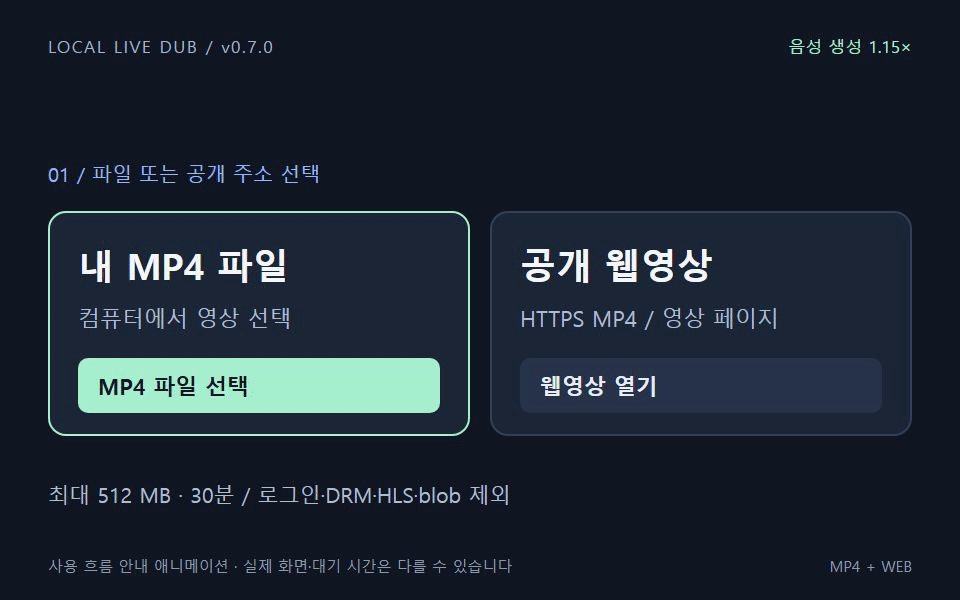

# Local Live Dub · v0.8.0


[**MP4·웹영상 지원 + Windows 자동 설치 ZIP 다운로드**](https://github.com/Choi-sungjin/youtube-live-dub-mvp/archive/refs/heads/main.zip) · [설치 순서](docs/auto-install-windows.md)



Remotion으로 만든 17초 사용 안내 GIF입니다. 실제 재생 녹화나 속도 측정 결과는 아니며, [실제 Chrome 검증 기록](docs/workflows/mp4-web-v0.7.0.md)과 [GIF 제작 소스·재생성 방법](docs/readme-demo/README.md)을 별도로 제공합니다.

유튜브의 원문 자막 또는 로컬 음성 인식 결과를 한국어로 번역하고, 영상 시간에 맞춰 더빙 음성을 재생하는 Chrome Manifest V3 확장 프로그램입니다. 현재 기본 경로는 **로컬 Gemma 4 E4B 번역 → Supertonic 3 음성 생성(1.15배)**입니다.

**다른 PC에서 처음 설치한다면 [Windows 자동 설치 안내](docs/auto-install-windows.md)를 먼저 따르세요.** 같은 PC의 로컬 서버·모델이 필요합니다. YouTube 확장에 더해 **MP4 파일과 공개 MP4 웹영상**을 로컬 플레이어에서 지원합니다. 로그인 전용·DRM·HLS·blob 스트림과 SNS 전체 지원은 포함하지 않습니다.


## 네 가지 더빙 모드

YouTube 패널의 **설정**에서 번역과 음성을 조합합니다. Gemma 4는 번역을 맡고, 로컬 음성은 Supertonic 3가 만듭니다.

| 모드 | 번역 | 음성 |
|---|---|---|
| 1. 모두 로컬 | Gemma 4 | Supertonic 3 |
| 2. 로컬 번역 + GPT 음성 | Gemma 4 | GPT Realtime |
| 3. GPT 번역 + 로컬 음성 | GPT | Supertonic 3 |
| 4. 모두 GPT | GPT | GPT Realtime |

원문 자막 수집·로컬 음성 인식은 공통입니다. GPT가 포함된 단계의 텍스트만 OpenAI에 전송하며 API 사용료가 발생합니다. 키는 서버에만 저장합니다. 모드 변경 시 기존 더빙을 멈추고 다음 시작부터 적용합니다. 첫 문장의 번역·음성이 준비되면 재생하고, 이어지는 문장을 순서대로 준비합니다. 문장 하나의 오디오 생성 완료 후 재생하는 방식이며, 생성 중인 PCM 조각을 브라우저에서 즉시 재생하는 방식은 아닙니다.

GPT 기본 모델은 번역 `gpt-6-luna`, 음성 `gpt-realtime-2.1-mini`입니다. `OPENAI_MODEL`, `OPENAI_VOICE_MODEL`로 변경할 수 있으며 해당 API·기능을 지원하는 모델이어야 합니다. 로컬 음성 속도는 1.15배, GPT 음성은 1배입니다.

```bash
npm ci
python3 scripts/set-openai-key.py
# 키를 숨김 입력한 뒤 로컬 서버를 재시작합니다.
```

키는 `backend/.env.local`에 저장되며 Git에서 제외됩니다. 키가 없거나 서비스가 실패하면 오류를 표시합니다. 다른 유료 제공자로 자동 전환하지 않습니다. 기존 v0.7 안내 GIF·검증 기록은 이전 버전 자료입니다.

Ubuntu 설치·시작 절차는 [Linux 안내](docs/install-linux.md)를 참고하세요.

## MP4 · 일반 웹영상

설치 후 **`start-player.cmd`**를 실행하거나 [로컬 플레이어](http://127.0.0.1:18789/player)를 엽니다. MP4 파일을 선택하거나 공개 MP4 주소를 넣고 **웹영상 열기 → 더빙 시작**을 누릅니다. MP4가 하나 포함된 정적 HTML 페이지 주소도 받을 수 있습니다. JavaScript로 만들어진 영상 주소는 확장 팝업의 **현재 페이지 영상 찾기 → 영상 가져오기**로 로컬 플레이어에 전달합니다. 원래 웹페이지 안에서 직접 더빙하는 방식은 아닙니다.

파일은 최대 **512 MB / 30분**, Chrome에서 재생 가능한 H.264/AAC MP4를 권장합니다. 첫 시작은 전체 음성 인식 후 현재 30초 구간을 준비합니다. 현재 위치보다 20초 앞에서 다음 구간을 미리 준비하고, 부족하면 영상이 기다린 뒤 이어집니다. 긴 음성은 마지막 음절까지 기다리므로 영상 총 시청 시간이 늘어날 수 있습니다. 음성 생성 **1.15배**는 고정이며 추가 속도 압축은 없습니다.

입력·사용법·제한과 실제 검사 결과는 [MP4·웹영상 워크플로우](docs/workflows/mp4-web-v0.7.0.md)에 있습니다. 기존 YouTube의 사용법은 아래와 같습니다.

**Windows 자동 설치:** 전체 ZIP을 압축 해제한 뒤 **`install-windows.cmd`를 더블클릭**하면 필수 도구·모델 다운로드, GPU/CPU 선택, 로컬 설정과 서버 시작을 진행합니다. 기본 음성 1.15배를 유지합니다. [자동 설치 포함 최신 ZIP 다운로드](https://github.com/Choi-sungjin/youtube-live-dub-mvp/archive/refs/heads/main.zip)와 [자동 설치 안내](docs/auto-install-windows.md)를 참고하세요. Chrome에서 `extension` 폴더를 불러오는 단계는 마지막에 직접 수행합니다.

최신 배포 코드는 [main 브랜치](https://github.com/Choi-sungjin/youtube-live-dub-mvp/tree/main)에서 받으세요. [최신 소스 ZIP 다운로드](https://github.com/Choi-sungjin/youtube-live-dub-mvp/archive/refs/heads/main.zip). 저장소가 Private이므로 접근 권한이 있는 GitHub 계정으로 로그인해야 합니다. ZIP은 압축을 풀고, Git을 사용할 경우 아래 명령으로 받으세요.

```powershell
git clone --branch main https://github.com/Choi-sungjin/youtube-live-dub-mvp.git
```

## 현재 실행 방법 (Windows)

```powershell
cd "$env:USERPROFILE\youtube-live-dub-mvp"
.\scripts\start-local.ps1
```

브라우저에서 http://127.0.0.1:18789/diagnostics 를 열면 실제 번역과 음성 재생을 먼저 확인할 수 있습니다.

1. 크롬의 `chrome://extensions`에서 기존 확장을 새로고침하거나, 개발자 모드의 압축해제 확장 불러오기로 `extension/` 폴더를 선택합니다.
2. 유튜브 영상을 새로고침합니다. 패널이 숨겨졌다면 확장 아이콘에서 Open을 선택합니다.
3. 패널 버전 **0.8.0**, Backend **http://127.0.0.1:18789**를 확인합니다.
4. 기본 음성 엔진 **Supertonic 3 · 로컬 음성 · 1.15배**에서 **Test**, **Start** 순서로 확인합니다.
5. 자동 서버 시작을 쓰려면 [native host 설치 안내](native-host/README.md)를 참고합니다. 수동 서버 실행 상태에서는 설치 없이 백엔드 연결이 가능합니다.

Supertonic 3는 이 PC의 모델을 한 번 불러온 뒤 계속 재사용합니다. **생성 속도는 1.15배로 고정**하고 WAV 파일에 반영합니다. 유튜브가 1배속일 때 더빙 플레이어도 1배속으로 재생하며, 자막 길이에 맞춘 추가 배속을 적용하지 않습니다. 유튜브 재생 속도를 사용자가 바꾸면 더빙도 영상 속도를 따릅니다. M1–M5, F1–F5 음성을 고를 수 있으며 피치·외부 API 모델 설정은 비활성화됩니다. 현재 로컬 경로의 번역·음성 생성에는 외부 AI API가 필요하지 않습니다.

Ollama가 실행 중이어야 합니다. 이 PC에는 `gemma4:e4b-it-q4_K_M`이 설치되어 있으며 서버 시작 때 미리 불러옵니다. 30분 메모리 유지와 10분 주기 갱신으로 다음 번역을 준비합니다. 새 PC에서는 Ollama 설치와 해당 모델 다운로드를 먼저 완료하세요. 서버가 임의로 모델을 다운로드하거나 외부 번역 API로 대체하지 않습니다.

`backend/.env`의 로컬 설정은 다음과 같습니다. 기존 키가 저장되어 있어도 이 경로에서는 Z.ai/OpenAI를 호출하지 않습니다.

```dotenv
TRANSLATION_PROVIDER=ollama
OLLAMA_BASE_URL=http://127.0.0.1:11434
OLLAMA_MODEL=gemma4:e4b-it-q4_K_M
TTS_PROVIDER=supertonic3
```

이전 YouTube 검사는 [24분 영상 후반 재생·SNS 확장 워크플로우](docs/workflows/live-dub-24min-and-sns-2026-10-18.md)에 보관합니다. [SNS 설계 결정서](docs/architecture/ADR-001-cross-platform-local-dubbing.md)의 캡처 경로는 여전히 프로토타입이며, v0.7.0은 MP4 파일을 먼저 확보하는 별도 VOD 플레이어로 연결했습니다. 기존 [19분 전체 영상 검사](docs/workflows/live-dub-full-video-2026-10-18.md)와 [로컬 Gemma 전환 기록](docs/workflows/live-dub-local-gemma-2026-10-18.md)도 보존합니다. v0.7.0 팝업을 사용하려면 Chrome 확장을 새로고침하세요.

새 PC에서는 [설치 안내](docs/install-windows.md)의 Python 3.12 가상환경·패키지·세 모델 다운로드·GPU/CPU 설정을 모두 준비하세요. 기존 PC의 전역 Python 패키지에 의존하지 않습니다. 모델은 최초 설정 때 다운로드하고, 서버 실행 중에는 자동 다운로드하지 않습니다.

공식 모델과 사용 조건은 [Supertonic 3 모델 카드](https://huggingface.co/Supertone/supertonic-3)를 참고하세요. Windows 로컬 음성과 Supertone HTTP API도 선택지로 유지됩니다. Supertonic 3는 별도 API 키 없이 로컬에서 음성을 합성합니다.

## 검증 범위

2026-11-02: 네 모드의 실제 API·로컬 음성 생성과 Chrome 연속 재생, 76개 개발 검사 결과는 [v0.8.0 검증 기록](docs/verification-2026-11-02/REPORT.md)에 있습니다.

2026-10-17: 실제 유튜브 원본 다운로드, 앞 20초 음성 인식, 한국어 번역, Windows 음성 생성과 크롬 진단 화면 오디오 재생을 확인했습니다. 당시 Supertone HTTP API 요청은 HTTP 404를 반환했습니다.

자세한 실행 결과와 남은 항목은 [검증 기록](docs/verification-2026-10-17/REPORT.md)에 있습니다. 기존 코드는 프로젝트 외부 백업 폴더에 보관했습니다.

2026-10-18: v0.5.2 검사에서 발견한 뒤로 탐색 버퍼 결함을 v0.5.3에서 수정했습니다. 사용자가 선택한 Stefan 3D AI의 새 영상(`2hqcDHnyJaY`)에서 실제 Supertonic 3 한국어 재생, 생성 속도 1.15/플레이어 1.00, 발화 중 일시정지, 앞으로 이동, Stop 후 원음량 복구, 재시작 직후 이전 구간으로 이동해 재생 복구를 확인했습니다. 회귀 검사 14개도 통과했습니다. 처음 보는 영상은 자막 수집·로컬 음성 인식·번역 준비 시간이 필요하며 초기 더빙 공백도 관찰했습니다. 전체 19분 완주 및 청감 품질 검사는 포함하지 않습니다. 결과와 증거는 [Chrome 검사 기록](docs/verification-2026-10-18/REPORT.md)에 있습니다.

## v0.6.0 성능 개선

처음 음성 인식 범위를 35초로 줄이고 지속 실행 작업을 재사용합니다. 번역 결과는 서버를 다시 켜도 파일 캐시에서 재사용하며, 음성은 최대 4문장씩 준비합니다. 현재 위치의 음성이 부족하면 영상을 기다리게 하고, 긴 문장은 1.15배 조건을 유지하면서 끝까지 재생합니다. 기존 Z.ai 구성의 동작과 Chrome 실측은 [이전 워크플로우 자료](docs/workflows/live-dub-v0.6.0-2026-10-18.md)에 남기며, 로컬 Gemma 검증과 구분합니다.

## 개발 검사

Claude 클라우드에서는 `npm run test:cloud`로 API 키 없이 개발 검사를 실행합니다.
환경 설정과 Windows 검증 절차는 [클라우드 개발 안내](docs/claude-cloud.md)를 참고하세요.

```powershell
npm.cmd run check
npm.cmd run test:prepare       # 모의 음성 / 외부 API 호출 없음
npm.cmd run test:regressions   # 회귀 테스트 / 외부 API 호출 없음
```

Z.ai/OpenAI/Supertone API를 별도로 선택한 실검사는 해당 제공자의 사용량을 소모합니다. 기본 로컬 Gemma/Supertonic 경로는 이 PC의 연산 자원을 사용합니다. 검증 스크립트의 `--tts-provider windows-sapi`는 Windows 로컬 음성을 사용합니다. 모의 문장/파형은 명시적인 테스트 모드에서만 사용하며, 실서비스 오류를 가리지 않습니다.

자막 추출용 도구는 `.venv-win`을 우선 사용합니다. 새 PC의 Node 22 이상, FFmpeg, faster-whisper 패키지와 사전 모델 다운로드 절차는 [설치 안내](docs/install-windows.md)에 정리했습니다.

## 구성

- `extension/`: 크롬 확장과 영상 동기화
- `backend/`: 로컬 서버, Supertonic 3 상주 작업 프로세스, 실제 WAV 캐시, 진단 화면
- `native-host/`: 크롬에서 로컬 서버를 시작하는 연결 프로그램
- `lib/`, `api/`: 기존 Vercel 서버 경로 (Supertonic 3 및 Windows 음성은 로컬 백엔드에서만 지원)
- `scripts/`: 음성 인식, 검증, 실행 도구

API 키는 서버의 환경 파일에서 읽고 브라우저에 전달하지 않습니다. GitHub에 코드를 올리는 것과 Vercel 배포는 별개이며, 이 버전은 Vercel에 배포하지 않았습니다.
