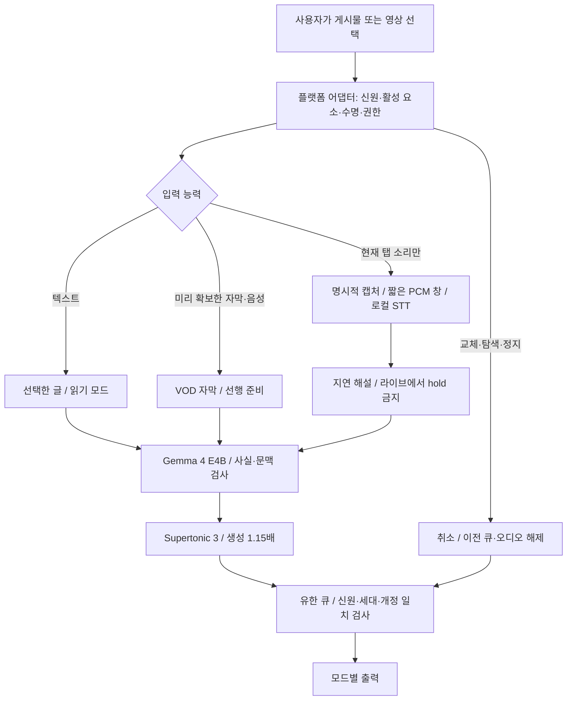

# ADR-001: 영문 SNS를 위한 로컬 번역·더빙 확장

- 날짜: 2026-10-18
- 상태: **설계 및 코어 프로토타입 작성. SNS 제품 연동은 미완료.**
- 요구사항: 로컬 Gemma 4 E4B, 의미를 유지한 짧은 번역, Supertonic 3 생성 1.15배 유지.
- 근거: 현재 YouTube 코드 검사, 실제 Chrome 재생, Grok Build의 두 차례 설계 검토, GPT 후속 검토, Chrome 공식 API 문서.
- 검토 경로: 사용자의 2026-10-18 지시에 따라 Gemini 계정 전환을 생략하고 후속 검토는 GPT로 진행한다. 기존 Grok 기록은 보존한다.

## 결론

사이트마다 번역기를 새로 만드는 대신 **콘텐츠 어댑터 + 공통 로컬 엔진 + 입력 능력에 따른 재생 모드**로 나눈다. 먼저 YouTube watch의 검증된 동작을 보존하고 텍스트 게시물, Shorts, 개별 VOD, 라이브 순으로 넓힌다. 모든 SNS를 한 번에 지원한다고 표시하지 않는다.

| 입력 | 가능한 첫 제품 동작 | 시간 기준 | 제한 |
|---|---|---|---|
| 미리 확보한 자막/원본 음성이 있는 VOD | 현재처럼 미리 번역·합성하고 영상에 맞춰 재생 | 영상 currentTime | 긴 한국어 문장에서는 영상 대기 가능 |
| 자막·원본 파일 없이 탭에서 지금 들리는 소리 | **지연 해설** | 캡처 샘플 시계 | 미래 소리를 못 듣는다. 같은 시점의 립싱크·무지연 더빙 불가 |
| 라이브 | 지연 상한을 둔 해설/번역 자막 | 캡처 시계 + 실제 라이브 위치 | 영상 대기로 해결하지 않는다. 오래된 해설은 상태를 표시하고 폐기 |
| 텍스트 게시물 | 선택한 글 번역 후 읽기 | 음성 시계 | 동영상 currentTime·seek를 사용하지 않는다 |

1.15는 음성 **생성 속도**다. 원본 영상의 `playbackRate=1.0`과 문장 끝 보존을 위한 정지는 별도 지표다. 1.15를 유지하면서 모든 발화의 정확한 의미·길이·실시간 위치를 언제나 동시에 보장할 수는 없다. 자막 없는 동기 더빙까지 원하면 사전 오디오 확보 또는 별도의 지연 영상 출력이 추가로 필요하다.

## 워크플로우

## 지금 작성한 코드와 경계

- `lib/media-session.js`: 원본 origin·플랫폼·mediaId·내용 revision으로 신원을 만들고, 영상 교체/seek/Stop마다 세대를 바꾼다. AbortSignal이 다른 결과도 거부한다. 클립 수와 음성 초 단위로 큐를 제한한다. 잘못되거나 낡은 결과의 자원을 해제한다.
- GPT 재검토에서 호출자의 clip 객체 변경이 큐 제한과 정렬을 바꾸는 문제를 재현·수정했다. 수락 시점의 id/start/duration을 별도 보관한다. `take` 이후 음성의 해제·최종 재생 검증·완료 이력은 출력 어댑터 책임으로 남는다.
- `selectDubbingMode`: 선행 자막이 있고 일시정지 가능한 VOD만 aligned-vod를 선택한다. 캡처만 가능한 경우 delayed-commentary로 분류하고 영상 hold를 허용하지 않는다.
- `scripts/test-media-session.js`: 늦은 응답, 같은 video 요소를 재사용하는 피드 교체, Stop, 큐 상한, 추적 쿼리를 제외한 신원, 중복 오디오 자원 해제를 검증한다.
- 이 코어는 **현재 확장에 아직 연결되지 않았다**. 실제 X/Reddit/Instagram/TikTok 지원, PCM 캡처, 오프스크린 출력, 서버 취소를 구현했다고 주장하지 않는다.
- `backend/caption-context.js`: 현재 YouTube에서 발견한 문맥 오류에 사용하는 별도 개선이다. 이웃 문장 전체를 짧은 캡션에 무작정 넣지 않고, 현재 단어에 해당하는 의미 힌트만 전달한다. 일반 자막에도 쓸 수 있지만 범용 의미 판정기는 아니다.
- `backend/verified-caption-terms.js`: 제작자 설명으로 확인한 용어만 해당 영상 ID에서 보정하고 rawText를 보존한다. SNS 확장에서도 임의의 일반 동음이의어 치환 대신 출처와 적용 범위를 가진 용어집이 필요하다.
- 실제 적용 결과와 검증 한계는 [24분 영상 후속 검사](../workflows/live-dub-24min-and-sns-2026-10-18.md)를 따른다. 회귀 테스트 52개가 통과했지만, v12의 첫 준비 11.64초와 캐시 없는 탐색 대기가 있어 아래 성능 목표를 달성했다고 볼 수 없다.

## 대안 비교

| 대안 | 이점 | 거절 또는 채택 이유 |
|---|---|---|
| 모든 사이트에 같은 content.js 주입 | 초기 코드가 적음 | YouTube ID·DOM·자막·시계에 결합돼 피드 교체와 광고에서 틀린 음성이 재생될 수 있음. 거절 |
| 모든 콘텐츠를 tabCapture로 처리 | 사이트 다운로드에 덜 의존 | 미래 음성 없음, 탭 전체 믹스, 원음 라우팅·재캡처 검증 필요. 제한적 fallback만 채택 |
| 원본 URL을 서버가 모두 다운로드 | 선행 STT에 유리 | 인증·URL 만료·DRM·SSRF·대용량 제약. 허용한 사이트의 지원 경로만 선택적으로 사용 |
| 어댑터 + 기능별 모드 | 기존 엔진 재사용, 실패 원인 분리 | 구현량은 늘지만 검증 가능한 단계 확장이 가능. 채택할 설계 |

## 반드시 막아야 할 실패

1. **잘못된 영상 소리**: URL만으로 신원을 삼지 않는다. 피드가 같은 DOM을 재사용해도 mediaId/revision을 바꾼다. 광고 여부나 동시에 재생되는 영상이 불명확하면 자동 더빙을 시작하지 않는다. iframe은 접근 권한이 있는 범위만 다룬다.
2. **캡처의 자기 피드백**: PCM 입력과 TTS 출력을 별도 그래프로 구성하고 더빙을 캡처 대상 페이지 안에 넣지 않는다. 분리했다는 설계만으로 통과 처리하지 않는다. TTS 표식 톤이 입력 PCM에 나타나는지 실제 Chrome에서 시험해야 한다.
3. **끝없는 로컬 추론 대기**: epoch는 결과 폐기 장치이며 GPU 취소 자체가 아니다. 서버에도 세션/작업 ID, in-flight 상한, 길이 제한, 우선순위, 취소, 오래된 응답 폐기가 필요하다. 취소 불가능한 엔진은 진행 중 1개가 끝날 때까지 새 작업을 제한한다. UI Stop은 서버 작업 종료를 기다리지 않고 재생부터 중지한다.
4. **원음이 사라짐**: tabCapture는 기본적으로 탭 소리를 사용자에게 직접 출력하지 않으므로 별도의 모니터 출력과 덕킹이 필요하다. Stop/권한 철회/워커 실패/탭 닫힘 후 복구를 시험한다. 사용자 mute 의도와 앱의 임시 mute를 구분한다.
5. **자연스럽지만 틀린 번역**: 숫자 값, 이름, 제한적 부정 패턴을 검사하되 일반 언어의 극성을 정규식으로 완전히 판정할 수 있다고 주장하지 않는다. 이미 감지한 의심 문장은 자동으로 음성 재생하지 않고 원문/번역 확인 상태로 보낸다. 검출하지 못한 오류가 남으므로 사람 검수 코퍼스가 별도로 필요하다.

## 권한·로컬 서버

새 도메인은 사용자 선택 시 최소 권한으로 추가하고 `<all_urls>`를 기본으로 쓰지 않는다. 사용자 제스처가 필요한 캡처는 사이트 호스트 권한만으로 대체되지 않는다. 캡처 스트림 ID는 즉시 소비하고 서비스 워커 재시작·offscreen 재생성·35초 이상 침묵을 시험한다.

현재 코드는 loopback에 바인딩하지만 서버 CORS가 `*`이고 background 메시지의 sender 검증이 약하다. **SNS의 호스트 권한을 넓히기 전에** 확장 오리진/송신 탭 검증, 로컬 세션 인증, 요청 크기·URL 허용 목록·리다이렉트/사설 주소 검사를 설계·적용한다. Chrome의 로컬 네트워크 허용 정책은 설치 버전에서 실제 확인한다. 이번 작업은 서버를 외부에 공개하지 않는다.

## 구현 순서와 통과 조건

| 단계 | 구현 범위 | 통과 조건(목표이며 현재 측정값 아님) |
|---|---|---|
| P0 | YouTube 기준선·회귀 자료 고정 | Start/Stop/앞뒤 seek/마지막 음절/1.15 유지. 버퍼 대기와 문장 끝 대기를 따로 기록 |
| P1 | 어댑터 계약·서버 취소·재생 직전 검증 | A→B 교체와 연속 seek 50회에서 이전 세대 음성 0개, 큐 상한 초과 0회, 취소되지 않는 엔진도 동시 실행 제한 유지 |
| P2 | 선택한 X 또는 Reddit 텍스트 읽기 | 선택 글만 처리, 본문/댓글 혼합 없음, 화면 교체·Stop 시 출력 종료, 동영상 시계 호출 없음 |
| P3 | YouTube Shorts/한 사이트 개별 VOD | 활성 영상·광고·반복 재생 식별, 원음 복구, 승인되지 않은 사이트 주입 0회 |
| P4 | 캡션 없는 VOD 캡처 | 30분 캡처에서 TTS 표식 톤 재유입 없음, 침묵/권한 철회/워커 재시작/동시 영상 시험. 실제 지연 p50/p95 공개 |
| P5 | 라이브 및 추가 피드 | hold 호출 0회, 오래된 해설 폐기 정책·표시 검증, 서버·큐 상한 유지 |

초기 성능 목표는 warmed VOD 첫 음성 p95 2초 이내, 준비된 VOD의 버퍼 부족 정지 0회/20분, 지연 해설 p95 5초 이내로 두되 **합격한 측정값이 아니다**. 영상 종류·길이·GPU 부하별로 측정하고 달성 못하면 기능 상태를 낮춘다. 번역·STT·TTS·브라우저 지연을 따로 기록해야 병목을 구분할 수 있다.

## 모델 검토 기록

- **Grok**: Chrome에서 Build를 선택해 실제 1차 검토와 반론 재검토를 받았다. [공식 Grok 4.7 가이드](https://docs.x.ai/developers/grok-4-7)는 Grok Build 기본 모델을 4.7로 안내하지만, 이 웹 UI는 원시 모델 ID를 표시하지 않았다. 따라서 API의 `model=grok-4.7` 응답 메타데이터를 검증했다고 쓰지 않는다. [1차 원문](reviews/grok-build-review-2026-10-18.md), [반론 응답](reviews/grok-build-counterreview-2026-10-18.md), [실제 대화](https://grok.com/c/9c209f20-d2e1-44d4-9210-1d167e814663).
- **Gemini 4 Argon High**: AI Studio에서 정확한 `gemini-4-argon`과 Thinking High를 선택했으나 당시 계정에서 실행할 수 없었다. **Gemini 응답은 받지 않았다.** 사용자는 다른 계정이라고 설명하고 GPT로 대체하도록 지시했다. 계정 전환이나 추가 접근 권한을 기다리는 과제는 종료한다. [공식 모델·thinking 문서](https://ai.google.dev/gemini-api/docs/latest-model?hl=en).
- **GPT**: 현재 Codex에서 코드·기존 실측·재현 시험으로 후속 검토했다. 큐 내부 정보 변경 문제를 수정하고 **53/53 회귀 시험**을 확인했다. 취소 전달, 첫 문장 우선 준비, 출력 자원 소유권과 재생 완료 이력은 별도 구현 과제로 구체화했다. [검토와 근거](reviews/gpt-review-2026-10-18.md). 이는 여러 모델의 독립적 합의나 새 SNS 실측 결과를 의미하지 않는다.
- 채택: 캡션/캡처/텍스트 모드 분리, 출력과 입력 분리, 서버 큐와 재생 큐 별도 제한, 실제 성능과 가정 분리.
- 반론: `playbackRate=1.0`과 표기된 hold를 구분하면 1.15 요구와 모순되지 않는다. 규칙 검사로 모든 부정을 판정할 수 없다. 표식 톤 시험은 **아직 실행하지 않은 필수 통과 시험**이다. Grok 두 번째 응답의 “아직 합격 조건이 아니다”는 표현은 채택하지 않았다.
- 남은 이견: 캡처 VOD에서 hold를 허용하면 입력을 스스로 멈출 수 있다. 초기 구현은 지연 해설에서 hold를 금지하고, 사전 입력 확보나 별도 지연 영상 출력이 완성된 뒤 다시 검토한다.

## 공식 자료

- [Chrome tabCapture](https://developer.chrome.com/docs/extensions/reference/api/tabCapture): 사용자 실행 후 캡처, 기본 오디오 억제와 다시 연결하는 방법, 스트림 ID 제약.
- [Chrome offscreen](https://developer.chrome.com/docs/extensions/reference/api/offscreen): MV3 DOM 컨텍스트, runtime 메시지, AUDIO_PLAYBACK의 침묵 수명.
- [Chrome 116 캡처 변경](https://developer.chrome.com/blog/chrome-116-beta-whats-new-for-extensions): 서비스 워커에서 받은 스트림 ID를 offscreen에서 소비하는 경로.

이 문서의 사이트별 가능성은 설계 판단이다. 실제 로그인 상태·DRM·DOM 변경·약관 조건까지 검증된 지원 목록이 아니다.
