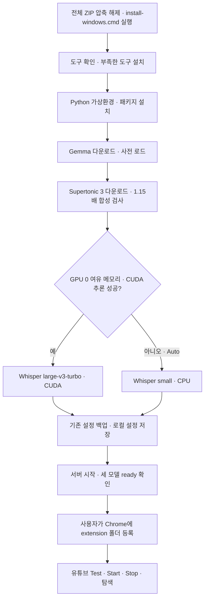

# Windows 자동 설치

ZIP을 **압축 해제한 뒤 프로젝트 맨 위의 `install-windows.cmd`를 더블클릭**한다. 기본값은 GPU 자동 선택이다. 기존 수동 설치 명령을 하나씩 실행할 필요가 없다. 음성 생성 속도는 **Supertonic 3에서 1.15배**, 일반 1배속 영상의 더빙 재생 속도는 1배로 유지한다.

자동 설치 추가본은 [codex/windows-auto-install ZIP](https://github.com/Choi-sungjin/youtube-live-dub-mvp/archive/refs/heads/codex/windows-auto-install.zip)에서 받을 수 있다. 비공개 저장소이므로 접근 권한이 있는 GitHub 계정으로 로그인한다. 설치 파일 하나만 받으면 필요한 소스와 requirements가 없으므로 전체 ZIP을 받는다.

## 실행 순서

1. Windows 10/11 **x64** PC에서 전체 ZIP을 받고 압축을 푼다. 설치 후에도 이 폴더를 유지한다.
2. `install-windows.cmd`를 실행한다. 도구 설치에 필요한 Windows 관리자 승인 창이 뜨면 확인한다. 별도의 관리자 계정으로 실행하면 모델·설정이 그 계정에 저장되므로 평소 사용하는 계정에서 시작한다.
3. 도구와 모델 다운로드, 검사, 서버 준비가 끝나 **SETUP COMPLETE**가 표시될 때까지 기다린다. 여러 GB를 다운로드하므로 네트워크·PC 사양에 따라 오래 걸릴 수 있다.
4. 열린 Chrome 확장 관리 화면에서 **개발자 모드 → 압축해제된 확장 프로그램 로드 → 이 프로젝트의 `extension` 폴더**를 선택한다. 이 마지막 등록 단계는 사용자가 직접 수행한다.
5. YouTube에서 패널의 **Test → Start → Stop → 앞뒤 구간 이동**을 확인한다.

Microsoft Store의 **앱 설치 관리자(App Installer/WinGet)**가 필요하다. 없으면 설치기가 [공식 WinGet 안내](https://aka.ms/getwinget)를 표시하고 중단한다. 앱 설치 관리자를 설치·업데이트한 뒤 같은 파일을 다시 실행한다. 시스템 실행 정책은 변경하지 않으며 CMD 실행기는 해당 PowerShell 프로세스에만 `ExecutionPolicy Bypass`를 사용한다. 회사 정책이나 Windows 차단을 우회하지 않는다.

## 자동으로 처리하는 일

| 단계 | 처리 |
|---|---|
| 필수 도구 | 이미 쓸 수 있는 도구는 재사용하고, 부족하면 WinGet으로 Node.js 22, Python 3.12, FFmpeg, Ollama, Chrome 설치 |
| Python | 프로젝트의 `.venv-win`에 고정된 requirements 설치. 다른 가상환경을 삭제하거나 전역 Python 패키지를 변경하지 않음 |
| 번역 | Ollama 실행 → `gemma4:e4b-it-q4_K_M` 다운로드 → 미리 불러오기 |
| 음성 | Supertonic 3 다운로드 → 실제 한국어 합성 검사, 생성 속도 **1.15** |
| GPU 선택 | Gemma를 불러온 뒤 NVIDIA GPU 0의 여유 메모리와 Whisper CUDA 실행 확인 |
| 음성 인식 | CUDA 성공 시 `large-v3-turbo / int8_float16`, 그 외 자동 모드에서는 `small / CPU int8` |
| 설정 | `backend/.env`의 로컬 번역·TTS·STT 설정 작성. 기존 파일은 `.cache`에 백업하고 관련 없는 설정과 키 보존 |
| 완료 확인 | 서버를 숨김 창으로 시작하고 Gemma·Supertonic·Whisper가 모두 준비됐는지 최대 10분 확인 |
| 마지막 안내 | Chrome 진단/확장 화면과 `extension` 폴더 열기 |

WinGet 설치는 [Microsoft 공식 install 옵션](https://learn.microsoft.com/en-us/windows/package-manager/winget/install)을 사용하며 패키지·소스 약관 수락 옵션을 포함한다. 다운로드 해시 검사와 Windows 보호 기능은 끄지 않는다. 모델은 각 도구의 로컬 캐시에 보관하며 GitHub에 업로드하지 않는다.

## GPU 선택 기준

- **Auto:** NVIDIA 드라이버의 `nvidia-smi`로 GPU 0을 조회한다. Gemma를 메모리에 올린 뒤 **여유 VRAM 3,072 MiB 이상**이면 CUDA 패키지를 설치하고 Whisper 모델로 짧은 실제 추론을 실행한다. 기준은 설치기의 보수적 선택 규칙이며 모든 GPU에서 성능·메모리 여유를 보장하는 사양표가 아니다.
- CUDA DLL·드라이버·모델 로드·추론이 실패하면 CPU 모델을 준비하고 CPU 설정을 기록한다. 중간 다운로드는 삭제하지 않는다.
- NVIDIA GPU가 없거나 조회할 수 없거나 여유 메모리가 부족하면 CPU 경로를 사용한다. AMD/Intel GPU는 **이 Whisper CUDA 경로**에서 사용하지 않는다. Gemma의 GPU 사용은 Ollama가 별도로 결정한다.
- **Cpu:** GPU 여부와 관계없이 Whisper를 CPU로 실행한다.
- **Cuda:** CUDA를 명시적으로 요청한다. 실패 시 CPU로 몰래 바꾸지 않고 오류로 종료한다.

```powershell
# 기본 자동 선택
.\install-windows.cmd

# Whisper를 CPU로 고정
.\install-windows.cmd -Device Cpu

# 변경 없는 준비 상태 확인: 다운로드/설정 저장/서버 변경 없음
.\install-windows.cmd -Plan

# 설치 완료 후 브라우저와 탐색기를 열지 않음
.\install-windows.cmd -NoBrowser
```

## 재실행과 오류 처리

설치 중 네트워크가 끊기거나 패키지 설치가 실패하면 성공으로 표시하지 않는다. 오류를 해결한 뒤 같은 설치기를 다시 실행한다. 기존 도구·모델 캐시를 재사용하며, pip/Ollama는 필요한 항목을 확인한다. 기존 `.venv-win`이 Python 3.12 x64가 아니면 보존한 채 오류로 중단하므로 새 폴더에 소스를 받아 설치한다.

이 설치기로 만든 서버는 `YLD_INSTALLATION_ID`가 일치할 때만 정상 종료 후 재설정한다. 18789 포트를 다른 앱이나 이전 수동 설치 서버가 사용 중이면 **자동 종료하지 않고 중단**한다. 기존 서버를 정상 종료한 뒤 재실행한다. 같은 폴더의 설치기를 동시에 두 번 실행할 수도 없다.

`backend/.cache/install-result.json`은 성공한 설치 실행의 기록이다. 현재 서버 상태는 `http://127.0.0.1:18789/api/health`로 확인한다. HTTP의 `ok: true`만으로 완료하지 않으며 세 모델의 ready와 선택한 모델·엔진이 일치해야 한다. 실패 로그는 `.cache/setup-server-*.err.log`, Ollama 시작 로그는 `.cache/ollama-*.err.log`에 있다. API 키·기존 환경 파일 내용을 로그에 출력하지 않는다. 기존 설정 백업에는 개인 값이 있을 수 있으므로 `.cache` 전체를 공유하지 않는다.

PC를 재부팅한 뒤에는 `scripts/start-local.ps1`로 서버를 다시 시작한다. 필요하면 [수동 설치 안내의 native host 등록](install-windows.md#8-선택-사항-크롬에서-서버-자동-시작)을 추가할 수 있다. 이 설치기는 로그인 시 자동 실행이나 Chrome native host 등록을 추가하지 않는다.

## 자동 설치 흐름



## 검증 범위

자동 설치 제어 흐름은 Windows PowerShell 5.1에서 임시 폴더와 가짜 외부 명령으로 검사한다. GPU 선택·CPU 전환·설정 보존·오류 중단·서버 식별·완료 판정을 검증하고, Python 보조 도구는 다운로드 없이 합성 속도와 지연 추론 오류 전달을 검사한다. `-Plan`은 현재 PC에서 실제 도구 탐지와 GPU 조회만 수행한다.

2026-10-18 확인 결과:

- `npm run test:cloud`: JavaScript 구문 35개, 회귀 검사 54개, Windows 설치 흐름 검사 13개, 모의 번역·음성 계약 통과.
- `python scripts/test-setup-models.py`: 모델 준비 도구 검사 4개 통과. 모델 호출은 대역으로 대체했으며 실제 다운로드 검사가 아니다.
- 현재 PC에서 Windows PowerShell 5.1의 `-Plan` 실행: 도구 5종과 NVIDIA 여유 메모리 조회 성공. 프로젝트 외부 디렉터리에서 시작해도 동작 확인.
- 별도 임시 코드 폴더의 실제 Node 서버로 설치 식별자와 모델 미준비 상태를 확인. 기존 서버와 개인 환경 파일은 사용하지 않음.

**깨끗한 두 번째 PC에서 WinGet 설치부터 YouTube 재생까지 완료한 검증은 아직 아니다.** 자동 설치가 성공하면 해당 PC에서 모델의 실제 합성·추론 검사는 수행되지만, Chrome 확장 로드와 실제 영상의 시작·정지·탐색은 마지막 단계에서 직접 확인해야 한다. 수동 구성과 문제 해결은 [Windows 상세 설치 안내](install-windows.md)를 참고한다.
