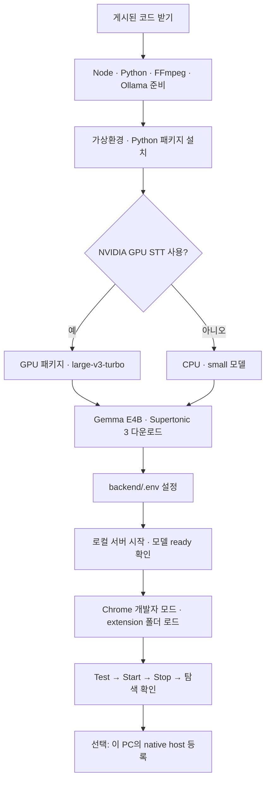

# 다른 Windows PC에 설치하기

이 프로그램은 **Chrome 확장 + 같은 PC의 로컬 서버 + 로컬 AI 모델**로 실행한다. GitHub는 코드를 전달하는 곳이며 번역 서버가 아니다. Chrome 웹 스토어 등록 없이 개발자 모드로 직접 설치할 수 있다.

기준 구성: 로컬 Gemma 4 E4B 번역, Supertonic 3 음성 생성 **1.15배**, 자막이 없을 때 faster-whisper 음성 인식. 현재 검증 대상은 YouTube 일반 동영상 페이지다. 다른 SNS는 설계·프로토타입 단계다.

**자동 설치를 원하면 [자동 설치 안내](auto-install-windows.md)의 ZIP을 받고 `install-windows.cmd`를 실행한다.** 필수 도구, Python 패키지, 모델 다운로드와 GPU/CPU 설정, 서버 시작을 처리한다. 아래는 직접 구성할 때 사용하는 수동 절차다.

> 최신 배포 코드는 [main 브랜치](https://github.com/Choi-sungjin/youtube-live-dub-mvp/tree/main) 또는 [소스 ZIP 다운로드](https://github.com/Choi-sungjin/youtube-live-dub-mvp/archive/refs/heads/main.zip)로 받는다. 게시·업데이트 절차는 [GitHub 게시 안내](publish-github.md)를 따른다. 모델·캐시·API 키·개인 환경 설정은 다운로드에 포함되지 않는다.

## 1. 준비물

| 준비물 | 설명 |
|---|---|
| Windows 64비트 + Chrome | 이 안내와 시작/native host 스크립트의 대상 환경 |
| [Git](https://git-scm.com/downloads/win) | 저장소 받기와 업데이트 |
| [Node.js](https://nodejs.org/en/download) | 22 이상 LTS 버전 사용. 로컬 서버와 자막 도구 실행 |
| [Python](https://www.python.org/downloads/windows/) | 현재 검증 구성은 3.12 64비트. 설치 시 Python Launcher 사용 가능하게 설치 |
| [Ollama](https://ollama.com/download/windows) | Gemma 모델 실행. 설치 후 앱 실행 유지 |
| [FFmpeg](https://ffmpeg.org/download.html) | Windows 빌드의 bin 폴더를 PATH에 추가. 이 프로젝트의 다운로드·오디오 구간 추출에 필요 |
| NVIDIA GPU + 드라이버 | 기존 GPU 음성 인식 구성을 사용할 경우 필요. 없으면 아래 CPU 경로 사용 |

설치 후 PowerShell을 새로 열어 다음 명령이 실행되는지 확인한다.

```powershell
git --version
node --version
py -3.12 --version
ollama --version
ffmpeg -version
```

모델 다운로드 공간과 실행 메모리가 필요하다. [현재 Gemma 태그](https://ollama.com/library/gemma4:e4b-it-q4_K_M)의 다운로드 크기는 약 6.6GB이며 실행 RAM/VRAM 요구량과 같지는 않다. Whisper·Supertonic·패키지 공간도 별도로 필요하다. GPU 종류와 동시 모델 메모리에 따라 속도가 달라져 이 PC의 재생 지연을 새 PC에 보장할 수 없다.

## 2. 코드 받기

**main 브랜치의 최신 배포 코드를 받는다.** 저장소는 Private이므로 권한 있는 GitHub 계정으로 인증한다.

```powershell
cd $env:USERPROFILE
git clone --branch main https://github.com/Choi-sungjin/youtube-live-dub-mvp.git
cd youtube-live-dub-mvp
```

같은 폴더가 이미 있다면 덮어쓰지 않고 기존 설치의 상태를 확인한다. Git을 쓰지 않으면 [main 소스 ZIP](https://github.com/Choi-sungjin/youtube-live-dub-mvp/archive/refs/heads/main.zip)을 받아 압축을 푼 뒤 프로젝트 폴더에서 PowerShell을 연다. ZIP 설치는 이후 `git pull` 업데이트를 사용할 수 없다.

## 3. Python 패키지 설치

프로젝트 폴더에서 실행한다. 새 PC는 기존 PC의 Python 설치에 의존하지 않는 가상환경을 만든다.

```powershell
py -3.12 -m venv .venv-win
.\.venv-win\Scripts\python.exe -m pip install --upgrade pip
.\.venv-win\Scripts\python.exe -m pip install -r requirements-tools.txt -r requirements-supertonic.txt -r requirements-stt-fast.txt
```

가상환경 활성화 없이 해당 python.exe를 직접 사용하므로 Activate.ps1은 필요 없다. 현재 로컬 Node 서버에는 npm 설치 의존성이 없다. `vercel dev`는 이 설치 경로에 필요하지 않다.

NVIDIA GPU 음성 인식을 사용할 PC는 추가로 실행한다.

```powershell
.\.venv-win\Scripts\python.exe -m pip install -r requirements-stt-gpu.txt
```

이 파일은 Windows용 NVIDIA DLL 패키지를 설치하며, 프로젝트의 `backend/cuda-runtime.py`가 작업 프로세스에 DLL 경로를 등록한다. NVIDIA 드라이버 자체를 설치하는 명령은 아니다. [faster-whisper 공식 요구사항](https://github.com/SYSTRAN/faster-whisper#gpu)의 CUDA 12/cuDNN 9와 호환되는 드라이버·실행 환경이 필요하다.

## 4. 모델을 미리 다운로드

Ollama 앱을 실행한 상태에서 Gemma와 Supertonic을 준비한다. 초기 다운로드에는 인터넷이 필요하다.

```powershell
ollama pull gemma4:e4b-it-q4_K_M
.\.venv-win\Scripts\python.exe -c "from supertonic import TTS; TTS(model='supertonic-3', auto_download=True)"
```

음성 인식은 다음 중 하나를 선택한다.

**NVIDIA GPU 경로 — 현재 검증한 모델과 같음:**

```powershell
.\.venv-win\Scripts\python.exe -c "from faster_whisper.utils import download_model; download_model('large-v3-turbo')"
```

**CPU 경로 — GPU 없이 동작을 확인할 때:**

```powershell
.\.venv-win\Scripts\python.exe -c "from faster_whisper.utils import download_model; download_model('small')"
```

CPU 경로는 인식 모델이 달라지므로 기존 GPU 결과와 품질·속도가 동일하지 않다. 실제 영상에서 별도 확인한다. 서버의 Whisper와 Supertonic은 자동 다운로드를 끈 상태로 실행되므로 이 단계를 생략하면 모델 로드가 실패한다. 모델은 각 도구의 사용자 캐시에 저장하며 GitHub에 넣지 않는다. 모델 사용 조건은 [Gemma 모델 페이지](https://ollama.com/library/gemma4:e4b-it-q4_K_M)와 [Supertonic 모델 카드](https://huggingface.co/Supertone/supertonic-3)를 따른다.

## 5. 로컬 설정 만들기

처음 설치할 때만 예시를 복사한다. 이미 설정 파일이 있으면 보존한다.

```powershell
if (-not (Test-Path -LiteralPath backend/.env)) {
    Copy-Item -LiteralPath backend/.env.example -Destination backend/.env
}
notepad backend/.env
```

NVIDIA GPU 경로의 최소 설정은 다음과 같다. 예시 파일의 같은 항목을 수정하고, `YLD_STT_...` 항목은 주석 `#`을 제거한다. 같은 이름을 중복 작성하지 않는다.

```dotenv
TRANSLATION_PROVIDER=ollama
OLLAMA_BASE_URL=http://127.0.0.1:11434
OLLAMA_MODEL=gemma4:e4b-it-q4_K_M
TTS_PROVIDER=supertonic3
YLD_STT_MODEL=large-v3-turbo
YLD_STT_DEVICE=cuda
YLD_STT_COMPUTE=int8_float16
```

CPU 경로라면 마지막 세 줄을 아래로 바꾼다.

```dotenv
YLD_STT_MODEL=small
YLD_STT_DEVICE=cpu
YLD_STT_COMPUTE=int8
```

기본 로컬 경로는 Z.ai·OpenAI·Supertone API 키가 필요 없다. 예시의 해당 키는 비워둔다. `SUPERTONE_SPEED`는 다른 HTTP API 엔진의 설정이며, 현재 선택한 `supertonic3`의 생성 속도는 코드에서 **1.15**로 고정된다.

## 6. 서버 시작과 모델 준비 확인

```powershell
npm.cmd run check
.\scripts\start-local.ps1
Invoke-RestMethod http://127.0.0.1:18789/api/health | ConvertTo-Json -Depth 4
```

PowerShell 정책 때문에 ps1이 차단되면 정책을 바꾸지 않고 아래 명령으로 터미널에서 서버를 실행할 수 있다. 이 경우 해당 창을 켜두고 다른 창에서 health를 확인한다.

```powershell
node backend/server.js
```

`ok: true`는 HTTP 서버 실행 확인이다. `localTranslation.ready`, `supertonic.ready`, `stt.ready`도 모두 true인지 확인한다. 첫 로드 동안에는 기다린 뒤 다시 확인하고, 계속 false면 `backend/.cache/local.stderr.log` 또는 실행 터미널의 오류를 확인한다.

브라우저에서 `http://127.0.0.1:18789/diagnostics`를 열어 백엔드 연결을 확인한다. 127.0.0.1은 **설치한 그 PC 자신**이다. 이전 PC의 IP 주소나 GitHub 주소로 바꾸지 않는다.

## 7. Chrome 확장 설치

1. 주소창에 `chrome://extensions` 입력.
2. **개발자 모드** 켜기.
3. **압축해제된 확장 프로그램을 로드합니다** 선택.
4. 받은 저장소 안의 **extension 폴더** 선택. 프로젝트 전체 폴더가 아니다.
5. YouTube 일반 영상 페이지를 열고 확장 아이콘으로 패널 열기.
6. Backend `http://127.0.0.1:18789`, 음성 엔진 `Supertonic 3 · 로컬 음성 · 1.15배` 확인.
7. **Test → Start**. 일시정지·Stop·앞뒤 탐색·원음량 복원까지 확인.

이 방법은 [Chrome 공식 개발자 모드 설치 절차](https://developer.chrome.com/docs/extensions/get-started/tutorial/hello-world#load-unpacked)를 사용한다. 현재 저장소의 버전은 0.6.1이지만, 설치 대상 릴리스의 manifest 버전을 기준으로 확인한다.

## 8. 선택 사항: 크롬에서 서버 자동 시작

수동 서버 실행만으로 먼저 검증한 뒤 추가한다. 새 PC의 확장 관리 화면에서 **그 PC의 확장 ID**를 복사해 실행한다.

```powershell
.\native-host\install-native-host.ps1 -ExtensionId "새_PC의_32자리_확장_ID" -Browser Chrome
```

실제 명령에는 안내 문구 대신 확장 ID를 넣는다. 이 스크립트는 현재 사용자 레지스트리에 native host를 등록한다. Chrome을 완전히 종료 후 다시 열고 Test로 확인한다. 다른 PC의 생성된 `native-host/com.youtube_live_dub.backend.json`을 복사하면 경로·확장 ID가 맞지 않을 수 있다. 자세한 내용은 [native host 안내](../native-host/README.md)를 따른다.

## 업데이트

Chrome 패널에서 Stop을 누르고 서버를 정상 종료한 뒤, main 브랜치에서 업데이트한다.

```powershell
git status --short
git pull --ff-only
```

이전 안내에 따라 `codex/dub-supertonic-cloud-sync` 브랜치를 받은 경우에는 `git status --short` 결과가 비어 있는지 확인한 뒤 아래 명령으로 main으로 전환한다. 변경 파일이 있으면 먼저 보존하고 확인하며, 강제 전환하지 않는다.

```powershell
git fetch origin
git switch main
git pull --ff-only
```

로컬 수정 때문에 실패하면 강제 초기화하지 않고 변경 내용을 먼저 확인한다. 패키지 요구사항이 바뀌었다면 해당 pip install을 다시 실행한다. 서버를 재시작하고, 확장 코드가 바뀌었으면 확장 관리 화면의 새로고침과 YouTube 페이지 새로고침도 수행한다.

## 설치 플로우차트



## 검증 범위

2026-10-18 현재 코드·requirements·모델 로드 방식·공식 설치 문서를 확인해 작성했다. 기존 PC는 Python 전역 패키지를 재사용하므로 새 PC 안내에서는 이를 배제했다. **깨끗한 두 번째 PC에서 설치를 실행한 결과는 아직 아니다.** 모델 다운로드·GPU 호환성과 실제 재생은 대상 PC에서 위 절차로 확인해야 한다.
