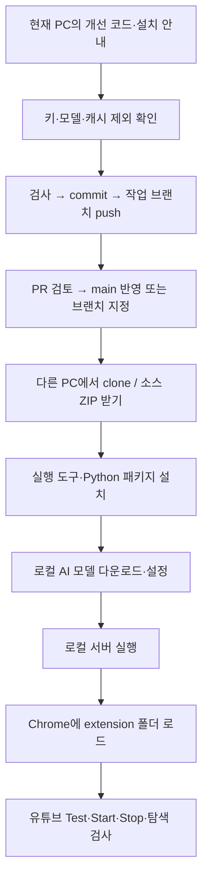

# GitHub 게시와 다른 PC 배포

기존 origin은 [Choi-sungjin/youtube-live-dub-mvp](https://github.com/Choi-sungjin/youtube-live-dub-mvp), 원격 기본·배포 브랜치는 `main`이다. 새 저장소를 만들거나 origin을 다시 추가할 필요는 없다. v0.6.1의 변경 내용은 [PR #1](https://github.com/Choi-sungjin/youtube-live-dub-mvp/pull/1)에서 확인한다.

설치자는 [main 브랜치](https://github.com/Choi-sungjin/youtube-live-dub-mvp/tree/main) 또는 [최신 소스 ZIP](https://github.com/Choi-sungjin/youtube-live-dub-mvp/archive/refs/heads/main.zip)을 받는다. Private 저장소이므로 권한 있는 계정으로 로그인한다. [Windows 설치 안내](install-windows.md)에 실행 도구·모델·Chrome 확장 준비 순서를 정리했다.

아래는 이후 업데이트에도 사용하는 게시 절차다. 로컬에서 파일을 고친 것만으로는 GitHub에 반영되지 않으며, commit과 push가 필요하다.

## 저장소에 붙일 설명

About에 넣을 짧은 설명:

> YouTube 영상을 로컬 AI로 한국어 번역·더빙하는 Windows용 Chrome 확장. Gemma 4 E4B와 Supertonic 3를 사용하며 음성 생성 속도는 1.15배입니다.

README 소개에 넣을 설명:

> Chrome 확장과 같은 PC에서 실행되는 로컬 서버로 구성됩니다. 원문 자막이 없으면 Whisper로 음성을 인식하고, Gemma 4 E4B로 의미를 유지하며 간결하게 번역한 뒤 Supertonic 3로 한국어 음성을 생성합니다. 기본 로컬 경로에는 외부 AI API 키가 필요하지 않습니다. 최초 설치 시 패키지·모델 다운로드가 필요하고, YouTube 영상 접근에도 인터넷을 사용합니다. Windows 설치 절차를 따라 로컬 서버를 준비한 뒤 Chrome 개발자 모드에서 extension 폴더를 불러오세요. 다른 SNS 지원은 아직 프로토타입 단계입니다.

README 상단에는 [새 PC 설치 안내](install-windows.md), 실행 화면, 현재 지원 범위, 버전별 검증 결과를 연결한다. 저장소를 공개해도 프로그램이 웹에서 자동 실행되거나 Chrome 웹 스토어에 등록되는 것은 아니다.

## 올리는 파일과 제외하는 파일

| GitHub에 포함 | 포함하지 않음 |
|---|---|
| `extension/`, `backend/` 소스 | `backend/.env`, API 키·개인 설정 |
| `lib/`, `api/`, `scripts/`, native host 설치 스크립트 | `.venv-win/`, `node_modules/` |
| `package.json`, `requirements-*.txt`, `.gitignore` | Gemma/Whisper/Supertonic 모델 가중치 |
| 값이 비어 있는 `backend/.env.example` | `backend/.cache/`의 원본 음성·생성 음성·로그 |
| README, 설치 안내, 설계·워크플로우 문서 | PC별 경로·확장 ID가 담긴 생성 native host JSON |
| 공개할 목적으로 검토한 그림·예제 | `docs/verification-*/`의 실제 검사 원본 |

현재 `.gitignore`에서 환경 파일, 가상환경, 서버 캐시, 생성 native host JSON, 검증 원본 폴더를 제외하는 것을 확인했다. ignore는 이미 추적된 파일을 자동 제거하지 않는다. 게시 전에 staged 목록을 확인한다. 검사 원본을 가리키는 과거 워크플로우의 링크는 GitHub에서 열리지 않을 수 있으므로 설치자에게는 README와 설치 안내를 먼저 제공한다.

## 최신 수정본 게시

현재 PC의 프로젝트에서 실행하는 예시다.

```powershell
cd "$env:USERPROFILE\youtube-live-dub-mvp"
git status --short
git branch --show-current
git remote -v
npm.cmd run check
npm.cmd run test:regressions
git diff --check
```

현재 작업이 작업 브랜치에 있는지 확인한 뒤 소스·설치 문서를 스테이징한다. 이후 변경은 새 작업 브랜치와 PR로 진행하며 main에 직접 push하지 않는다.

```powershell
git add README.md .gitignore package.json requirements-*.txt extension backend lib api scripts native-host docs
git diff --cached --stat
git diff --cached --name-only
git diff --cached --check
```

키, 모델, 음성 파일 등이 포함되지 않았는지 변경 내용을 확인한 다음 커밋·push한다.

```powershell
git commit -m "Prepare local dubbing and Windows installation guide"
git push -u origin HEAD
```

GitHub 저장소에서 작업 브랜치의 Pull Request를 만들어 검토한 뒤 `main`에 반영한다. 같은 브랜치의 열린 PR이 있다면 중복 생성하지 않고 기존 PR을 갱신한다. **설치자에게는 main 링크를 제공하고, 병합 전 검증이 필요한 경우에만 해당 작업 브랜치를 안내한다.** 절차의 근거는 [GitHub 공식 기존 코드 게시 안내](https://docs.github.com/en/migrations/importing-source-code/using-the-command-line-to-import-source-code/adding-locally-hosted-code-to-github)다.

반복 설치용으로는 검증한 커밋에 태그를 붙여 Release로 안내한다. 태그가 가리키는 커밋, `package.json`과 manifest 버전이 맞는지 확인한다. 모델이나 개인 설정을 포함한 작업 폴더 전체 ZIP 대신 저장소의 소스 ZIP을 사용한다. 공개 오픈소스로 배포하려면 프로젝트 LICENSE도 별도로 결정한다. 현재 저장소에서 추적 중인 LICENSE 파일은 확인되지 않았다.

## 설치자에게 전달할 메시지

> GitHub 저장소의 main 또는 최신 소스 ZIP을 받아 주세요. 이 프로그램은 확장만 설치하는 방식이 아니라 Windows에 로컬 AI 서버와 모델도 준비해야 합니다. README의 **다른 PC 설치 안내**대로 Node.js·Python·FFmpeg·Ollama와 모델을 설치하고, 서버를 시작한 다음 Chrome 개발자 모드에서 **extension 폴더**를 선택하세요. 기본 번역·음성 생성에는 API 키가 필요 없으며 음성은 1.15배로 생성됩니다. GPU가 없는 경우 CPU 설치 경로를 사용하되 처리 속도와 인식 품질은 따로 확인해야 합니다.

## 게시부터 실행까지


