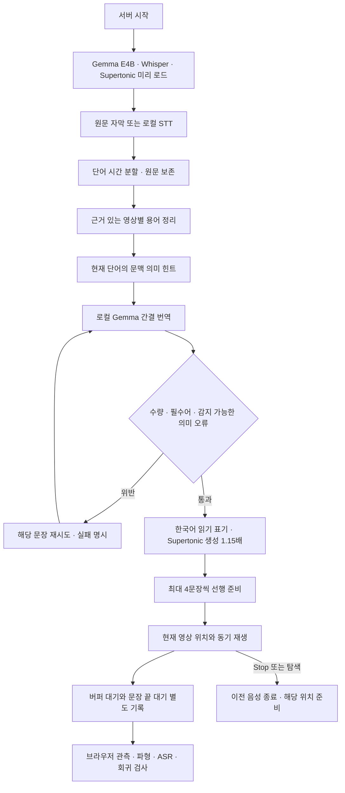

# 24분 영상 후반 재생·번역 보정과 SNS 확장 워크플로우

2026-10-18 KST · 확장 0.6.1 · 최종 백엔드 `gemma-concise-v12` · 음성 표기 `ko-terms-trim-v5`

이 문서는 [이전 19분 영상 및 숫자 오류 검사](live-dub-full-video-2026-10-18.md)를 보존한 후속 기록이다. 대상은 [구독자들이 AI로 만든 역대급 게임들을 플레이해봤습니다](https://www.youtube.com/watch?v=6a5VLKPlJRo), 실제 길이 **1461.841초(24:21)**다. 이전 요청의 19분 영상과 다른 영상이다.

## 결과와 검증 범위

**5:50.58부터 끝까지 Chrome에서 재생 범위를 확인했다. 단일 무중단 완주는 아니다.** 23:44.81까지 재생한 탭이 Learn3D 페이지로 이동하여, 별도 탭에서 23:41.81부터 마지막까지 겹쳐 재생했다. 새 번역 규칙은 전체 재생 후 적용하고 문제 구간에서 다시 검사했다.

| 검사 | 실제 범위·결과 |
|---|---|
| 첫 재생, v11 | 05:03:28경 시작 → 05:21:25.302 마지막 관측. 영상 350.58–1424.81초 |
| 이어 재생, v11 | 05:22:14 시작, 영상 1421.81초부터. 05:23:02.084에 영상과 마지막 음성 완료 확인 |
| 버퍼 부족 정지 | 첫 재생 0회, 이어 재생 0회 |
| 문장 끝 보존 대기 | 첫 재생 7회, 이어 재생 1회. 추가 가속·음성 잘림을 피하려고 영상이 기다린 횟수 |
| 마지막 문장 | 영상 1461.84초 완료, 더빙 4.49/4.49초 완료 |
| 속도 | Supertonic 3 **생성 1.15배**, 실제 음성 플레이어와 영상 **1.00배** |
| 시작 지연 | 첫 재생 0.29초, 새 탭 이어 재생 2.17초. 모델과 일부 자막·번역·음성이 준비된 캐시 조건 |
| 준비 방식 | 첫 재생 중 자막 153구간/140청크 → 438구간/396청크로 증가. 전부 미리 생성한 단일 파일 재생이 아님 |
| 기록 | 첫 재생 59개, 이어 재생 88개 관측. 관측 사이 모든 발화를 사람이 청취한 기록은 아님 |

재생 도중 별도 v12 번역 실험도 수행했다. 통제된 성능 벤치마크가 아닌 개발 중 실제 사용 관측이다. `재생 클립`은 재생 호출 수이며 서로 다른 음성 수가 아니다. 위의 버퍼 0회를 모든 시작·탐색에 일반화하지 않는다.

## 발견한 오류와 반영한 개선

| 문제 | 조치 | 실제 로컬 API 재검사 예 |
|---|---|---|
| 전투의 skill을 개인 실력으로 해석 | 주변 combat/cooldown/spell에 근거한 의미 힌트만 전달 | “스킬이 좀 있어야 할 텐데.” |
| cast를 캐스팅으로 표현 | 전투와 낚시 문맥을 구분 | “스킬을 시전할 수 있네요.” / “좋아요, 던질게요.” |
| Muck 인명을 진흙으로 번역 | 주변 Captain Muck 표기와 현재 문장의 이름 일치 검사 | “머크가 여기 있다. 출항하자.” |
| 플레이하면서 설명하는 말을 개발 시점으로 오해 | 특정 설명 삽입구를 번역 입력에서 분리하고 시간 관계 오류 검사 | “이 게임도 주로 Claude가 개발했더라고요.” |
| again 같은 필러에서 작별 인사 생성 | 원문에 인사가 없으면 인사 번역을 재시도 | “역시 정말 쉬워요.” |
| effort levels / like Opus / Otherwise 오해 | 추론 강도·담화 필러·평가 문맥 지침 추가 | “작업 복잡도에 따라 추론 강도가 달라져요.” / “Opus가 귀 같은 여러 요소를…” |
| Dash / Dirt 같은 짧은 핵심어 누락 | 간결화에서도 이름·행동을 보존하도록 지침 강화 | “한번 해보죠. 대시.” / “다른 Dirt 시리즈 같은 거요.” |
| Tripo 제품명이 Tripod/Tripop으로 인식 | 제작자의 실제 설명·고정 댓글의 TripoAI 링크에 근거해 **이 영상에만** 교정. rawText 보존 | “모델은 Tripo로 분할 생성됐어요.” |
| 영문 이름 음성 읽기 불안정 | 표시 번역과 별개로 TimeTalk→타임토크, Tripo→트리포, Godot→고도, Dirt→더트 | 재인식에서 “타임토크”, “트리포” 확인 |
| 이전 숫자 오류 재발 우려 | v11의 수량 환산 검사 유지 | 30 billion tokens → **300억 토큰**, 6.69초 음성 재인식 일치 |

`backend/caption-context.js`는 이웃 문장을 번역 대상에 합치지 않고 현재 단어의 의미를 제한적으로 제공한다. 캐시 키에 실제 사용한 문맥과 규칙 revision을 포함했다. 원래 자막은 보존한다. 일반 언어의 모든 모호함을 해결하는 범용 의미 판정기는 아니다.

## v12 실제 Chrome 재검사

05:31–05:33에 별도 검사 탭에서 Start → 뒤로 탐색 → 일시정지 → 앞으로 탐색 → 재개 → Stop → Start → 재탐색 → 최종 Stop을 실행했다.

- 10:14 부근 첫 시작은 **11.64초**로 측정됐다. 번역·발음 revision 변경 후 준비가 필요한 경로로, 앞의 v11 캐시 시작 0.29초와 직접 비교할 수 없다. 이를 빠른 시작 목표 달성으로 처리하지 않는다.
- 7:18로 뒤로 이동 시 준비된 음성이 없어 **버퍼 대기 1회** 후 자동으로 재생이 재개됐다. 7:34에는 올바른 새 위치의 음성을 재생했다.
- 일시정지 시 영상과 더빙이 함께 멈췄다. 앞으로 이동한 동안 이전 음성이 남지 않았고 재개 후 해당 구간이 재생됐다.
- Stop 후 더빙 없음, 원본 음량 100% 복원을 확인했다. 재시작 첫 음성은 **1.26초**였다.
- 재시작 후 숫자 키와 화살표를 연속 사용한 재탐색에서도 누적 **버퍼 대기 1회**가 기록됐다. 첫 세션과 다른 세션의 카운터이며 두 값을 합쳐 0회라고 쓰지 않는다.
- 영상 646.54–653.82초에서 수정한 “이 게임도 주로 Claude가 개발했더라고요.”가 실제 패널에 표시되고 1.15배 생성 음성이 재생되는 것을 확인했다.
- 마지막 관측은 666.70초 일시정지, stopped, 더빙 없음, 원본 음량 100%다. v12로 5:50부터 끝까지 다시 완주한 결과는 아니다.

관측 JSON의 label 일부는 작업 의도를 표시한다. `restart-while-paused` 등 이름만으로 일시정지를 판정하지 않고 실제 `media.paused`와 패널 값을 사용한다.

## 음성·발음 검사

| 대상 | 파형 및 재인식 결과 |
|---|---|
| v11 생성 파일 347개 | 클리핑 샘플 0, 전체 무음 파일 0, 파일 내부 최대 저에너지 구간 520ms |
| v12 최종 API 응답의 18개 파일 | 클리핑 샘플 0, 전체 무음 파일 0, 최대 저에너지 구간 480ms |
| 속도 | 두 집합 모두 기록된 생성 속도 1.15 |
| 방법 | PCM16 파형 20ms RMS 창, 임계값 0.008. 로컬 Whisper large-v3-turbo로 한국어 재인식 |

347개에는 다시 준비한 중복 시간대의 파일이 포함된다. 실제로 들린 서로 다른 문장 347개라는 의미가 아니다. 파형 결과는 파일의 손상·무음 점검이며 문장 사이 브라우저 끊김은 별도 재생 진단을 사용한다. ASR 문자열 일치율은 번역 정확도나 사람의 발음 평가 점수가 아니다.

**남은 불확실성:** 일부 게임 이름과 불명확한 원문 인식은 여전히 검수가 필요하다. 18개 재인식 중 “한번 해보죠. 대시.”의 마지막 “대시”가 ASR에서 빠졌으나, 이것만으로 TTS가 실제 단어를 생략했다고 확정하지 않았다. `라인 끊김` 같은 표현도 더 자연스럽게 만들 여지가 있다. 원문 STT의 어색한 `It deserves really good job` 등은 정확한 원음 확인 없이 임의로 바꾸지 않았다. 전체 구간을 사람이 직접 들으며 정확도·자연스러움을 채점한 결과는 아니다.

## 현재 처리 워크플로우

더빙의 STT·번역·TTS는 로컬이다. 아래 Grok 검토는 사용자가 요청한 설계 분석이며 영상 더빙의 클라우드 번역 경로가 아니다.

## SNS 확장 및 모델 검토

[SNS 설계 결정서](../architecture/ADR-001-cross-platform-local-dubbing.md)에 모드별 제약·대안·실패 조건·단계별 통과 시험을 보관했다. `lib/media-session.js`에 영상 신원, 세대별 취소, 유한 큐, 오래된 응답 거부 프로토타입을 구현했다. **현재 확장에 연결하거나 X/Reddit/Instagram/TikTok을 지원 완료한 것은 아니다.**

Grok Build에 실제 1차 검토와 반론 검토를 요청하여 결과를 저장했다. 공식 안내의 Build 기본 모델은 4.7이지만 이 웹 UI에서 원시 모델 ID까지 확인되지는 않았다. Gemini 4 Argon과 Thinking High는 실제로 선택했으나 당시 계정에서 실행할 수 없어 응답을 받지 못했다. 이후 사용자는 다른 계정임을 설명하고 GPT로 대체하도록 지시했다. **Gemini 접근 경로를 기다리지 않고 GPT 검토로 진행한다.** 권한·결제·API 키 생성은 진행하지 않았다.

[GPT 후속 검토](../architecture/reviews/gpt-review-2026-10-18.md)에서 SNS 코어의 외부 객체 변경에 따른 큐 제한·정렬 오류를 재현·수정했다. 후속 회귀 시험은 **53/53 통과**, JavaScript 34개 문법 통과다. 아래 52개 시험은 영상 검사를 마친 당시 기록으로 보존한다. 이번 GPT 검토는 새 브라우저 재생 결과가 아니며 실제 더빙 엔진 Gemma E4B와 Supertonic 3 생성 1.15배를 변경하지 않았다.

핵심 결정은 텍스트 읽기 → Shorts/개별 VOD → 캡처 기반 지연 해설 순으로 확장하는 것이다. 지금 들리는 소리만 얻는 캡처는 미래 발화를 먼저 번역할 수 없으므로, 무지연 동기 더빙으로 표시하지 않는다. 먼저 서버 취소·접근 검증과 실제 자기 피드백 검사를 완료해야 한다.

## 검증 및 보관

- `npm run test:regressions`: **52/52 통과**.
- `npm run check`: **JavaScript 34개 문법 통과**, 확장 0.6.1.
- `scripts/test-speech-trim.py`: 발화 샘플·샘플레이트 보존, 앞뒤 무음만 축소하는 검사 통과.
- `git diff --check`: 공백 오류 없음. 줄바꿈 형식 안내만 출력.
- 실제 로컬 prepare API: 5개 요청, 18개 구간 성공. 실제 Chrome 재검사 16개 관측.
- 최종 health: Gemma `gemma4:e4b-it-q4_K_M` / v12, Whisper GPU, Supertonic 3 모두 ready, translation lastError 없음.

백엔드 변경만 적용했으므로 확장 0.6.1을 추가 새로고침할 필요는 없다. 서버를 정상 종료 후 재시작하여 적용했고 모델은 미리 로드된 상태다.

다음 증거는 `docs/verification-2026-10-18/`에 보존하며 Git에서는 제외한다.

| 파일 | 내용 |
|---|---|
| `24min-from-350-v11.json` | 5:50–23:44 관측 |
| `24min-tail-v11.json`, `24min-end-complete.png` | 마지막 40초와 영상·음성 완료 |
| `24min-audio-v11.jsonl` | 생성 파일 347개 파형·재인식 |
| `caption-api-v12-speech-v5.json` | 최종 18구간 실제 API 결과 |
| `24min-repaired-audio-v12.jsonl` | 위 18구간 파형·재인식 |
| `24min-browser-v12.json`, `24min-v12-spot-check.png` | v12 시작·정지·탐색·재시작 증거 |
| `grok-counterreview.png`, `gemini-argon-high-access.png` | 실제 모델 검토 화면과 Gemini 실행 권한 제한 |

Grok 원문은 Git에 포함되는 [1차 검토](../architecture/reviews/grok-build-review-2026-10-18.md), [반론 검토](../architecture/reviews/grok-build-counterreview-2026-10-18.md)에 따로 보관한다.
