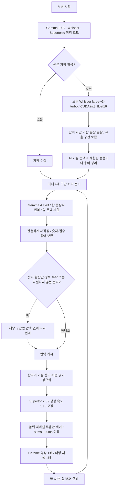

# 19분 영상 전체 더빙 검증과 개선

2026-10-18 KST · 이 기록의 전체 재생: 확장 0.6.0 / `gemma-concise-v8` · 이 기록의 최종 수정: 확장 0.6.1 / `gemma-concise-v11`

> 후속 검사와 현재 v12 상태는 [24분 영상 후반 재생·SNS 확장 워크플로우](live-dub-24min-and-sns-2026-10-18.md)에 기록했다. 아래의 마지막 위치 350.58초와 v11 상태는 이 검사를 마친 당시의 기록이다.

이 문서는 [이전 로컬 Gemma 검사](live-dub-local-gemma-2026-10-18.md)를 보존하고 확장한 기록이다. 대상은 [Google's Gemini 4 Is Finally Good at 3D Design & Blender?](https://www.youtube.com/watch?v=2hqcDHnyJaY), 길이 1140.061초 영상이다. Chrome의 한국어 제목과 새로고침 직후 영어 제목이 다르게 표시됐다. 그 원인은 확정하지 않았으며 영상 ID와 실제 내용을 기준으로 검사했다.

## 현재 검사 상태

**0초부터 19분 끝까지 실제 Chrome 재생을 완료했다. 다만 완전 무결한 재생은 아니었다.** 버퍼 부족 정지는 없었지만 문장 끝 보존 대기, 짧은 음절 재시작, 마지막 문장 잘림을 발견했다.

| 항목 | 실측과 의미 |
|---|---|
| 전체 재생 | 04:03:47경 시작 → 04:23:16.828 완료, 영상 1140.06초 |
| 경과 시간 | 약 19분 29초. 마지막 관측 시각을 사용한 근삿값 |
| 버퍼 대기 | 누적 0회. 원문과 음성을 사전 준비한 캐시 조건 |
| 문장 끝 보존 | 33회. 약 29초의 추가 경과에는 이 대기와 관측 간격이 포함됨 |
| 음성 속도 | Supertonic 생성 1.15배, 영상과 더빙 플레이어 1.00배 |
| 원문 / 더빙 구간 | 원문 347개 / 더빙 312개 |
| 재생 호출 | 355회. 서로 다른 음성 355개를 의미하지 않음. 짧은 음절 재시작을 별도 재현 |
| 마지막 문장 | 영상 완료 때 3.47/4.32초에서 일시정지, 약 0.85초 잘림 |
| 화면 기록 | 총 171개 관측. 일부 구간 약 2초 간격, 도구 작업 중 간격이 긴 부분도 있음 |

수정본 v0.6.1에서 첫 음절 재시작과 영상 종료 시 음성 중단을 고쳤다. **사용자가 확장을 새로고침한 뒤 실제 Chrome에서 시작·일시정지·재개·앞뒤 탐색·Stop·재시작·마지막 음성 완료를 재검증했다.** 아래의 19분 연속 재생 결과는 v8 백엔드와 기존 플레이어에서 얻은 값이며, 최종 수정본은 문제 구간 중심으로 재검사했다. 수정본의 19분 전체 재완주 결과는 아니다.

## 처리 흐름

원문 음성 인식, 번역, 음성 생성은 모두 로컬이다. 유튜브 콘텐츠 수집에는 네트워크를 쓴다. 음성의 발화 샘플을 추가 가속하지 않는다. 길어진 문장은 영상만 잠시 기다려 끝을 보존한다. 번역은 문장별 요청으로 이웃 문장의 정보 혼입을 줄인다. 10단어를 넘는 원문에만 앞 문맥 최대 180자를 참고로 제공하며 뒤 문맥은 보내지 않는다.

## 발견한 문제와 조치

| 실제 발견 | 변경 | 검증 방법 |
|---|---|---|
| tiny 원문에서 3D·제품명·문장 의미 오인식 | 설치된 large-v3-turbo를 GPU에 유지, CUDA DLL 경로를 프로젝트 내부에서 등록 | 실제 원본 WAV의 전체 로컬 인식 |
| `treaty`가 조약으로 번역, `not that bright` 중간 분리 | 이전 인식 문맥 유지, 단어 타임스탬프 사용, 부정·전치사 뒤의 강제 분할 지연 | 해당 원문이 `3D`, 완전한 부정 문장으로 복구됨 |
| 재인식한 동일 구간이 기존 캐시와 중복 | 모델 변경 시 이전 파일 보관, 재인식 창과 겹치는 기존 구간 교체 | 현재 전체 원문 캐시와 변경 로직 확인 |
| 음성마다 긴 앞뒤 무음 | 저레벨 외곽 무음만 정리, 앞 80ms / 뒤 120ms 보존 | 샘플·재생률 보존 테스트와 실제 WAV 분석 |
| Gemini·Opus·GPT·버전 읽기 불안정 | 한국어 발음용 별도 텍스트, 화면 번역은 원래 정보 유지 | 생성 WAV를 로컬 ASR로 재인식 |
| `좋아요, 해봅시다. ქ` 때문에 Supertonic 실패·세션 중단 | 한국어/라틴 이외 문자 감지 후 한 구간 재번역 | 재현 회귀 테스트 및 전체 생성 사전 검사 |
| Cloud Opus, Hicksfield, high effort 등을 일반 단어로 해석 | AI 모델 문맥에서 제한적 원문 별칭 정리, 용어 보존 검사 | 수정 전후 번역 대조 |
| 짧은 감탄문에 이웃 문장의 사실 추가 | 문장별 요청, 짧은 문장에 주변 문맥 제외 | 637.69초: “자, 그럼 시작합니다.” |
| 과거 예상을 실제 결과로 번역 | 예상 표현 검사·복구 | 668.93초: “사용하게 될 거라고 생각했어요…” |
| 선택 질문을 추천 문장으로 변환 | 질문 유형 전달·형식 검사 | 565.17초 선택 질문 복구 |
| only 설정 제한 누락 | 선택의 제한을 보존 | 246.05초: “높은 추론 강도만 있죠?” |
| 순위 비교 방향 반전 | X after Y의 순위를 명시 | 1107.97초: “Gemini 4가 GPT-6보다 낮아요.” |
| 마지막 “다음 영상에서 요.” | 원문에 see you / next가 있을 때만 동사 복구 | 실제 API: “다음 영상에서 봐요.”, 4.38초 WAV |
| 짧은 음성의 첫 음절 재시작 | 같은 구간의 완료된 오디오를 다시 play하지 않음 | 회귀 검사 + Chrome 첫 8개 음성 재생 호출 8회 |
| 마지막 약 0.85초 잘림 | 영상 ended와 사용자 pause 구분, 이미 재생 중인 끝 문장은 완료 허용 | Chrome에서 영상 종료 후 3.63 → 3.80 → 4.12 → 4.38/4.38초 완료 |
| “제미나이 5 나올 때 요.”의 빠진 동사 | 원문 see you / when에 근거한 제한적 보정 | 실제 v11 API: “제미나이 5 나오면 또 봐요.”, 1.77초 |

## v0.6.1 실제 Chrome 재검사

2026-10-18 04:46–04:49 KST. 사용자가 원래 탭에서 새 24분 영상을 재생 중이어서, 19분 검사 영상은 별도 Chrome 탭에서 확인했다. 패널 v0.6.1과 재생 코드 `completed-clip-v2`가 실제 표시됐다.

| 동작 | 결과 |
|---|---|
| 처음 시작 | 준비된 캐시 조건 첫 더빙 0.29초. 35.63초까지 첫 8개 음성 각각 한 번 재생, 버퍼 대기 0 |
| 발화 중 일시정지 | 영상 45.98초, 음성 0.14/1.41초에서 약 5초간 함께 정지 |
| 재개 | 두 재생 시계가 다시 증가하고 다음 문장으로 진행 |
| 앞으로 이동 | 약 1026초로 이동, 해당 구간 음성 재생. 준비 대기 누적 1회 뒤 재개 |
| 뒤로 이동 | 약 114초로 이동, 이전 음성을 끊고 해당 구간 재생 |
| Stop | 발화 중 음성 제거, 원음량 100% 복구. 약 5초간 다시 재생되지 않음 |
| 재시작 직후 뒤로 이동 | 약 141초에서 Start 후 즉시 0초 이동. 첫 더빙 0.52초, 8.58초까지 4개 음성 정상 |
| 마지막 문장 | 영상 1140.06초 완료 뒤에도 음성 진행, 최종 4.38/4.38초 완료. 생성 1.15 / 플레이어 1.00 |
| 종료 후 Stop | 완료 상태에서 음성 제거와 원음량 복구 |

이 재검사는 전체 재완주가 아니다. 앞 이동에서 발생한 준비 대기 1회를 숨기지 않으며, 최초 영상/모델 로딩 시간과 캐시 시작 시간을 구분한다.

## 새 24분 영상의 숫자 오류와 v11 수정

사용자가 [This Game Was Built Only With AI in 11 Weeks](https://www.youtube.com/watch?v=6a5VLKPlJRo), 24분 21초 영상에서 `Local translation lost a number in segment 75`를 보고했다. 262.298–271.378초 원문에는 **30 billion tokens**가 있었고 Gemma는 **300억 토큰**으로 맞게 번역했다. 기존 검사기가 원문의 숫자 문자열 30만 찾는 바람에 올바른 환산을 누락으로 오인했다. 실제 v10 모델 요청 3회에서 이 실패를 재현했다.

v11에서는 thousand/million/billion/trillion 및 한국어 큰 수 단위를 수치로 환산해 검사한다. 30 billion → 300억, 150 million → 1.5억은 허용하고, 30 billion → 30억/30/3억은 계속 거부한다. 버전·식별자 숫자 보존 검사도 유지한다. 이번 수정은 백엔드이며 추가 확장 새로고침이 필요하지 않다.

- 실제 Gemma 재검사: 오류 문장이 모델 요청 1회로 “300억 토큰 이상”을 포함해 통과.
- Chrome 재생: 해당 음성 **6.86/6.86초 완료**, 다음 문장으로 진행. 확장된 자막의 인덱스는 달라질 수 있으므로 원문·시각으로 동일 구간을 확인했다.
- 별도 API에 원래 index 75로 다시 요청: HTTP 200, 실제 Supertonic 1.15배 음성 생성. 이 파일은 7.15초이며 로컬 ASR도 “300억 토큰”으로 재인식, 클리핑 0개. 브라우저 캐시의 6.86초 파일과 구분한다.
- 검사 중 확장 연결이 무효화되는 별도 오류가 한 번 발생했다. YouTube 페이지 새로고침으로 연결을 복구한 뒤, 같은 문장 재완료와 약 348초까지 후속 재생을 확인했다. 숫자 누락 오류는 재발하지 않았다.
- 복구 후 세션: 첫 더빙 1.13초(캐시 조건), 버퍼 부족 대기 0회, 문장 끝 보존 1회. 새 24분 영상 전체 완주 결과는 아니다.
- 최종 회귀 검사 **41/41 통과**, JavaScript 29개 문법 검사 통과. 숫자 환산 오탐뿐 아니라 잘못된 환산을 거부하는 테스트 포함.

## v10 전체 생성·파형 검사 기록

v10으로 312개 구간을 실제 생성했다. 78개 요청, 실패 0, 경과 241.524초다. 준비 요청 중앙값 2.971초, 95백분위 3.727초, 최대 17.404초였다. 일부 기존 음성 캐시를 재사용했고 로컬 품질 검사도 함께 실행했으므로 새 영상의 최초 실행 또는 번역 모델 단독 속도로 해석하지 않는다.

312개 WAV를 전부 로컬 ASR로 재인식하고 파형을 검사했다. 클리핑 샘플 0개, 전체 무음 파일 0개, 검사 임계값 기준 파일 내부 최대 무음 520ms였다. 이후 마지막 문장의 동사만 복구하여 다시 생성했다(`final-outro-v10.json`). 이 4.38초 파일도 별도로 검사해 “다음 영상에서 봐요”가 재인식되고 클리핑 0개임을 확인했다(`final-outro-audio-check.json`).

- JavaScript 회귀 검사 **39/39 통과**.
- JavaScript **29개 파일 문법 검사 통과**, 패키지/확장 버전 0.6.1 일치.
- 무음 제거 테스트 통과: 샘플레이트와 내부 음성 샘플 전체 유지.
- `git diff --check` 오류 없음. 줄바꿈 변환 경고는 별도.

## 검사 조건과 증거의 범위

- 전체 재생에 앞서 원문 347개 구간을 확보했다. Chrome의 기존 분할 기준으로 더빙 312개 구간이다.
- 전체 생성 사전 검사: v7 197.845초, v8 198.313초, v9 230.832초, v10 241.524초. 각각 312개, 실패 0. 일부 음성 캐시는 재사용했다.
- 따라서 전체 재생은 원문과 준비된 음성 캐시를 이용하는 조건이다. 처음 보는 영상의 다운로드·최초 STT·미캐시 전체 지연을 대표하지 않는다.
- 첫 더빙 표시 시간은 사용자가 일시정지한 채 기다린 시간도 포함한다. v6의 30.08초, v8의 4.88초는 순수 서버 지연으로 사용하지 않는다. v5 실제 자동 재개 검사의 3.19초도 그 당시 캐시 상태에 한정한다.
- 화면에 표시된 시간·속도·버퍼·문장 끝 보존·원문·번역을 주기적으로 기록했다. `buffering` 문구 자체는 백그라운드 준비일 수 있으므로 `버퍼 대기` 누적 횟수와 영상 정지 상태를 확인했다.
- 발음 평가는 생성 WAV의 로컬 ASR 재인식과 파형 분석이다. 사람이 스피커로 전 구간을 청취한 평가가 아니며, 자연스러움·억양·동음이의어를 완전히 보증하지 않는다. 숫자/영문 표기 차이 때문에 원시 문자열 유사도를 발음 정확도 점수로 제시하지 않는다.
- 원문 STT도 모델 추정이다. 특히 3.26초 can/can't, 고유명사 등은 사람의 원음 확인이 남는다. 정답 자막이 없으므로 정확도 백분율을 제시하지 않는다.
- 의미 보존 때문에 긴 문장이 남는다. 예: 668.93초 구간 약 4.2초, 생성 음성 5.58초. 1.15배를 유지하므로 문장 끝 보존 대기는 여전히 생길 수 있다.

## 실행과 남은 브라우저 검사

이 PC는 로컬 Ollama `gemma4:e4b-it-q4_K_M`, Supertonic 3, Whisper `large-v3-turbo` / CUDA / `int8_float16`을 사용한다. 기존 외부 API 키는 삭제하지 않았고 현재 선택 경로에서는 사용하지 않는다. 서버 실행은 기존 `scripts/start-local.ps1`을 사용한다. 새 PC의 GPU 인식에는 설치된 Whisper 모델과 `requirements-stt-gpu.txt`의 라이브러리가 필요하다. 요구사항은 [faster-whisper 공식 안내](https://github.com/SYSTRAN/faster-whisper)를 참고한다.

이 검사를 마친 당시 백엔드는 v0.6.1 / 번역 규칙 v11이며 모델을 미리 불러둔 상태였다. 당시 마지막 Chrome 관측은 새 영상 `6a5VLKPlJRo`의 350.58초 일시정지, 상태 stopped, 더빙 없음, 원본 음량 100%였다. 더빙 중 원본 음량 설정 15%는 유지했다. 이후 전체 후반 재생과 v12 개선은 위 후속 문서를 따른다.

패널 **v0.6.1**, 재생 진단 **completed-clip-v2**에서 요청된 동작 재검사를 완료했다. 추가 변경 후에는 같은 절차로 다시 확인한다. 확장을 새로고침하면 기존 페이지 연결이 끊길 수 있으므로 YouTube 페이지도 새로고침한다. v11 숫자 검사 변경에는 확장 새로고침이 필요하지 않다.

## 증거 파일

프로젝트의 `docs/verification-2026-10-18/`에 보존하며 Git에서는 제외된다.

- `full-video-baseline-v4.json`: 기존 인식 사용 시 첫 검사.
- `full-video-gemma-v6.json`: 개선 중 검사와 실제 지원 문자 실패. 일부 파일에는 다음 단계 초기 관측도 있으므로 시각과 label로 구분한다.
- `full-video-gemma-v8.json`: 0초부터 끝까지 전체 연속 재생 기록 171개.
- `full-video-ended-v8.png`: 19분 완료와 마지막 음성 잘림 화면.
- `full-video-summary.json`: 재생·생성·파형 집계.
- `source-v5-before-context-fix.json`, `source-v6-final.json`, `source-v8-final.json`: 원문 변경 근거.
- `preflight-full-v7.jsonl`부터 `preflight-full-v10.jsonl`: 실제 준비 API 응답과 지연·음성 정보.
- `generated-audio-v5.jsonl`부터 `generated-audio-v10.jsonl`: 실제 음성 재인식·파형 지표.
- `final-quality-probes-v10.json`: 의미 오류 수정 구간의 실제 응답.
- `final-outro-v10.json`: 마지막 동사 복구 후 실제 음성 응답.
- `final-outro-audio-check.json`: 복구한 마지막 음성의 별도 ASR·파형 검사.
- `browser-v0.6.1-retest.json`: 수정 플레이어 동작 재검사 174개 관측.
- `v0.6.1-final-sentence-complete.png`: 영상 19분 완료 뒤 음성 4.38초 완료 화면.
- `number-error-before.json`, `number-error-after.json`: 실제 Gemma 숫자 오류 재현·수정 전후 요청과 응답.
- `browser-number-fix-v11.json`: 새 영상의 숫자 구간 재생, 연결 무효화, 복구, 정지까지 144개 관측.
- `v0.6.1-number-fix-verified.png`: 300억 토큰 번역과 음성 재생 화면. 전체 길이 완료는 JSON 관측에 기록됐다.
- `number-fix-api-v11.json`, `number-fix-audio-v11.json`: 원래 index 75로 API·음성 재검사.
- `closing-fix-api-v11.json`: 두 인사말의 최종 번역·음성 응답.
- `final-browser-summary.json`: 이번 두 영상의 재검사 요약.

이전 전체 재생 기록과 이번 문제 구간 재검사 기록은 별도 파일로 보존했다.
