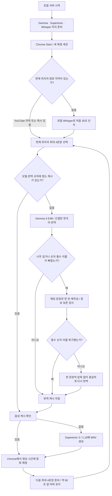

# 로컬 Gemma 번역·더빙 워크플로우

> 이 문서는 초기 전환 당시 기록이다. 이후 19분 완주와 v0.6.1 수정은 [전체 영상 워크플로우](live-dub-full-video-2026-10-18.md)를 참고한다.

2026-10-18 · Chrome 확장 v0.6.0 + 로컬 백엔드 `gemma-concise-v4`

현재 구성은 **YouTube 자막 또는 로컬 Whisper → 로컬 Gemma 4 E4B → 로컬 Supertonic 3**입니다. 자막 수집을 제외한 AI 처리는 이 PC에서 수행합니다. 음성 생성 속도는 **1.15배 고정**입니다. 이전 Z.ai 구성의 기록은 [기존 워크플로우](live-dub-v0.6.0-2026-10-18.md)에 별도로 보존합니다.

검사 영상: [Stefan 3D AI · 이제 블렌더 없이도 모듈형 3D 캐릭터를 만들 수 있습니다](https://www.youtube.com/watch?v=2hqcDHnyJaY), 약 19분.

## 처리 순서

기존 자막을 사용할 수 있으면 Whisper를 거치지 않습니다. 자막이 없으면 원본 오디오 다운로드와 음성 인식이 필요합니다. 따라서 번역만 빨라져도 처음 보는 영상의 전체 시작 대기 시간이 항상 같은 비율로 줄지는 않습니다.

## 모델 준비와 실행 설정

| 항목 | 현재 설정 |
|---|---|
| 번역 제공자 | `ollama`, `http://127.0.0.1:11434` |
| 모델 | `gemma4:e4b-it-q4_K_M` |
| 로컬 서버 | `http://127.0.0.1:18789` |
| GPU 확인 | RTX 5080 16GB, `ollama ps`에서 100% GPU, 컨텍스트 4096 |
| 모델 유지 | 요청마다 `keep_alive: 30m`, 서버 실행 중 10분 주기 준비 갱신 |
| 생성 설정 | `think: false`, temperature 0, JSON 스키마로 출력 구조 제한 |
| 번역 길이 | 한국어는 자막 길이 × 초당 6.5자, 6–160자 범위를 목표로 함 |
| 음성 | Supertonic 3, M1, WAV 생성 속도 1.15 |
| 재생 배속 | YouTube 1배속에서 더빙 플레이어 1.00배; 추가 가속 없음 |

Ollama 앱이 실행 중이어야 하며 모델은 미리 설치되어 있어야 합니다. 서버는 시작하자마자 모델을 준비하지만 자동 다운로드는 하지 않습니다. 처음 모델을 읽은 별도 측정은 37.219초였고, 이미 올라온 모델의 이번 서버 준비 요청은 0.376초였습니다. 이는 서로 다른 준비 상태의 측정이며 항상 0.376초가 걸린다는 뜻은 아닙니다.

Gemma가 응답하지 않으면 로컬 오류를 표시합니다. Z.ai/OpenAI로 자동 전환하지 않습니다. 기존 API 키는 삭제하지 않았고 이 경로에서 사용하지 않습니다. 클라우드 서버 경로에서 `ollama`를 선택하면 로컬 서버가 필요하다는 오류를 반환합니다. 사용자가 음성 엔진을 Supertone API로 별도 선택하면 그 음성 요청은 외부 API를 사용하므로, 이 문서의 로컬 조건은 **Supertonic 3 선택 시** 적용됩니다.

준비 확인은 [로컬 진단 화면](http://127.0.0.1:18789/diagnostics)의 `번역: ollama`, 모델명, `Gemma 모델: 준비 완료`를 봅니다. 서버만 바꾼 이번 수정에는 확장 재설치가 필요하지 않습니다.

## 짧게 번역하면서 보존하는 정보

한 번에 최대 4문장을 번역하고, 길이 목표를 넘거나 필수 정보가 빠진 문장만 한 번 더 다듬습니다. 숫자·버전 및 명시적 용어 목록(예: Blender/블렌더, Google/구글, Gemini/제미나이)을 검사합니다. `X20` 같은 영문·숫자 식별자도 보존합니다. 번호가 다른 문장에 섞이거나 문장이 누락된 결과도 검사합니다.

- 의미, 이름, 수량, 부정, 비교, 인과관계와 확신의 정도를 보존하도록 지시합니다.
- 수정안에서 필수 정보가 빠지면 완전한 첫 번역을 유지합니다. 처음 번역에도 그 정보가 없으면 해당 원문 한 문장만 분리해 길이 압축 없이 한 번 더 번역합니다. 그래도 복구하지 못하면 오류로 처리합니다.
- 글자 수를 맞추려고 문장 뒤를 잘라내지 않습니다. 길어도 완전한 문장이 우선입니다.
- `Do not turn off the power before saving version 3.1.`은 `버전 3.1 저장 전 전원을 끄지 마세요.`로 실제 생성됐습니다.
- `Use Blender 4.2, not 4.1. This does not require an internet connection.`은 `4.1 대신 Blender 4.2를 쓰세요. 인터넷 연결 불필요합니다.`로 실제 생성됐습니다. 이름·버전·부정이 유지되며, 5초 구간의 음성은 5.642초로 길이 목표를 약간 넘었습니다.

이 검사는 완전한 의미 동등성을 보장하는 장치가 아닙니다. 현재 영상의 tiny Whisper 결과에는 단어가 불분명하거나 문장 중간에서 끊긴 자막도 있습니다. 원문 인식 오류와 로컬 소형 모델의 오역은 여전히 가능하며, 전체 영상의 번역·발음 청감 검수는 별도입니다.

## 버퍼링·정지·탐색

현재 위치의 음성이 없으면 영상을 잠시 대기시키고 그 위치부터 먼저 준비합니다. 준비가 끝나면 재개하며, 이미 분석된 무음 구간은 그대로 지나갑니다. 긴 음성은 말끝을 자르지 않고 영상만 잠시 기다립니다. **1.15배와 말끝 보존을 유지하면서 모든 영상 정지를 없앨 수 있다고 보장하지 않습니다.**

Stop은 현재 음성을 중단하고 원음량·음소거 상태를 복구합니다. 이전 세션에서 늦게 도착한 준비 응답은 재생하지 않습니다. 앞/뒤 탐색은 이전 음성을 멈추고 새 위치의 문장과 버퍼를 선택합니다. 미분석 위치라면 그 위치 주변을 우선 인식합니다.

번역 캐시는 제공자·모델·번역 규칙 버전·언어·원문·시간을 구분합니다. 이전 Z.ai 또는 이전 Gemma 규칙의 번역을 새 결과로 오인하여 재사용하지 않습니다. 기존 캐시와 원자료를 삭제하지 않았습니다.

## 현재 영상 문장으로 측정한 서버 결과 — v3 기준 기록

실제 로컬 모델과 Supertonic 3를 사용했습니다. 번역 캐시 적중 0, 음성 캐시 미스 4개씩, 모델은 준비된 상태입니다. 별도 테스트 영상 식별자로 WAV 캐시 적중을 방지했습니다. **이 표는 Chrome Start 버튼부터 첫 소리까지의 시간이 아닙니다.**

| 문장 묶음 | 번역(재작성 포함) | 음성 생성 | HTTP 전체 |
|---|---:|---:|---:|
| 영상 처음 4문장 | 1.411초 | 2.168초 | 3.585초 |
| 약 243초의 4문장 | 7.227초 | 2.465초 | 9.697초 |
| 약 573초의 4문장 | 1.269초 | 1.598초 | 2.871초 |

v3 구현의 평균 번역 시간은 **3.302초**였습니다. 한 묶음은 7초 이상 걸려 요청별 변동이 있습니다. 이전 같은 자막 묶음의 Z.ai 번역 평균은 7.650초였지만, 새 구현은 지시문·구조 제한·재작성 단계가 달라 엄밀하게 같은 조건의 배수 비교로 해석하지 않습니다.

7.227초 요청이 반복되는지 확인하기 위해 같은 프로덕션 번역 모듈에서 세 묶음을 각각 2회 추가 요청했습니다. 실제 Ollama 사용, 애플리케이션 캐시 없음, 음성 합성 제외 조건에서 **1.107–1.771초, 6회 평균 1.353초**였습니다. 최초 번역과 재작성 모두 포함합니다. 각 Ollama 호출의 모델 적재 시간은 3–4ms였습니다. 추가 검사에서는 긴 지연이 재현되지 않았으며, 최초 지연의 원인은 확정하지 않습니다. 원래 측정값도 삭제하지 않습니다.

별도 첫 비교에서 동일한 번역 지시문을 사용한 단순 로컬 요청은 평균 0.799초, Z.ai는 7.650초였습니다. 이 9.6배 수치는 초기 단순 번역의 참고값이며 현재 구현 전체의 속도라고 제시하지 않습니다.

12개 음성 중 자막 길이를 **0.15초 이상 초과한 문장은 초기 로컬 번역 8개 → v3 2개**였습니다. 양수 초과 길이의 합계는 약 7.443초 → 1.347초입니다. 모두 같은 M1, 생성 속도 1.15이며, 실제 재생 대기 횟수와는 별도 지표입니다. 문장 사이 무음 구간이 있거나 경계 처리 방식에 따라 영상 대기 횟수는 달라집니다.

## 검증 상태

### 최종 v4: 실제 Chrome 시작·정지·탐색 검사

Chrome에서 기존 세션을 비우도록 YouTube 페이지를 새로고침하고 검사했습니다. 실행 중 `/health`는 `ollama`, `gemma4:e4b-it-q4_K_M`, `gemma-concise-v4`, 모델 준비 완료를 반환했고, 실제 번역 호출 수가 증가했습니다. 이전 Z.ai 세션의 재생 결과를 재사용하지 않았습니다.

| 조작 | 실제 관찰 |
|---|---|
| Start | 영상 약 121초에서 시작, 패널 첫 더빙 **1.50초** |
| 연속 재생 | 약 **120초** 동안 영상 121→236초 진행, **음성 부족 버퍼 대기 0회**, 문장 끝 보존 대기 4회 |
| 영상 일시정지 | 영상 235.72초, 더빙 3.00/4.32초에서 함께 정지. 약 20초 뒤에도 같은 위치 유지 |
| 재개 | 영상 236.19초, 더빙 3.49/4.32초로 함께 진행 |
| 미분석 위치로 앞으로 이동 | 키보드 탐색으로 912.03초 이동. 이전 음성 제거, 영상 대기 1회. 약 15초 뒤 관찰에서 영상 919.97초와 새 한국어 음성 재생 확인 |
| Stop | 현재 더빙 제거. 당시 원음량 25%에서 시작 전 100%로 복원. 약 9초 뒤에도 더빙 없음 |
| 재시작 직후 뒤로 이동 | 약 942초에서 Start 후 즉시 0초 탐색. 앞 구간으로 복구, 첫 더빙 지표 **6.11초**. 이전 위치의 음성 대신 0초부터 이어지는 문장 재생 |
| 마지막 정리 | Stop 후 영상도 일시정지. 52.03초, 더빙 없음, 원음량 100% |
| 배속 | 실제 재생 중 생성 속도 **1.15**, 더빙 플레이어 **1.00** 확인 |

모델이 준비되어 있고 원본 오디오·기존 자막·일부 음성이 캐시에 있는 조건입니다. 서로 다른 위치의 1.50초와 6.11초를 같은 조건의 성능 비교로 해석하지 않습니다. 미분석 탐색의 회복 시간은 샘플 간 관찰 상한이며 정확한 시작 순간을 계측한 값이 아닙니다. 전체 19분 완주와 사람이 듣는 음질 평가는 포함하지 않았습니다.

### 실제 재생에서 발견하고 수정한 결함

v3 첫 Chrome 검사에서는 첫 음성이 3.81초에 나왔지만, 다음 구간을 준비하다 `Local translation lost a number in segment 56` 오류로 세션이 중단됐습니다. 원문 `100 bucks. X20 cost 200 bucks...`와 다음 문장의 `200, 30 bucks...`에서 숫자/식별자를 생략하거나 합치는 문제가 있었습니다. 이전 성공처럼 취급하지 않고 [실패 원자료](../verification-2026-10-18/local-gemma-chrome-v3-failure.json)를 보관합니다.

v4는 숫자가 포함된 식별자를 보존하고, 일반 압축으로 필수 정보를 복구하지 못한 문장에 **원문 한 문장만 분리한 비압축 재번역**을 한 번 더 수행합니다. 해당 실패 자막을 실제 모델로 다시 처리했고, 위 Chrome 연속 재생에서 문제 구간을 지나 영상 235.72초까지 재생했습니다. 이 경로의 회귀 검사도 추가했습니다. 모든 번역 오류를 자동 복구한다는 보장은 아니며, 마지막 검사까지 실패하면 잘못된 문장을 정상 결과로 숨기지 않습니다.

### 최종 v4 속도와 음성 길이

- 준비된 모델에 같은 네 문장 묶음을 6회 요청한 실제 번역 시간: **1.034–1.681초**, 평균 **1.252초**. 애플리케이션 번역 캐시 없이 초기 번역·필요한 재작성 시간을 포함하며, 음성 합성은 제외했습니다.
- 실제 영상 12문장과 별도 의미 보존 2문장의 API 생성 성공. 모두 Supertonic 3, 생성 속도 1.15였습니다. 첫 두 묶음의 번역은 직전 Chrome에서 생성된 v4 캐시 적중 4개씩이며, 세 번째 묶음은 번역 캐시 적중 0개입니다. 이 API 응답 시간들을 캐시 없는 번역 속도로 사용하지 않습니다.
- 최종 12문장 WAV에서 0.15초 이상 구간 초과는 **2/12**였고, 양수 초과 길이의 합계는 **2.442초**였습니다. 초기 단순 로컬 번역의 8/12·7.443초보다 줄었지만, 의미를 남기기 위해 길어진 문장은 여전히 있습니다.

| 검사 | 결과 |
|---|---|
| JavaScript 문법 및 버전 일치 | 26개 파일 통과 |
| 회귀 검사 | 30/30 통과 |
| 모의 번역·음성 API 계약 | 2문장 통과; 실모델 검사가 아님 |
| 실제 Gemma + Supertonic API | 영상 12문장과 의미 보존 2문장, 모두 생성 성공 |
| 음성 생성 속도 | 모든 실제 응답 `speechSpeed: 1.15` |
| 실제 Chrome 진단 화면 | 로컬 제공자·모델 준비 완료, 새 문장 생성 0.99초, 오디오 재생 시작과 완료 확인 |
| 현재 YouTube 영상 Start/Stop/앞·뒤 탐색/연속 재생 | 위 v4 실제 검사 통과. 음성 부족 대기와 말끝 보존 대기를 구분해 기록 |

이전 Chrome 시작·정지·탐색 검사(첫 음성 11.33초 등)는 **Z.ai 구성**의 결과입니다. 이를 Gemma 구성의 브라우저 검증으로 재사용하지 않습니다. 아직 전체 19분 완주·모든 탐색 위치·사람의 번역 및 발음 평가는 완료하지 않았습니다. 이번 변경과 30개 회귀 검사는 이 PC의 로컬 작업에 적용됐으며, 다른 대화가 확인한 클라우드 커밋 `6662b13`의 22개 검사와는 범위가 다릅니다.

## 원자료와 구현

로컬 원자료는 `docs/verification-2026-10-18/`에 보관하며 기존 Git 제외 정책을 유지합니다.

- [최종 v4 서버 실측 JSON](../verification-2026-10-18/local-switch-prepare-v4.json)
- [이전 v3 서버 실측 JSON](../verification-2026-10-18/local-switch-prepare-v3.json)
- [준비된 모델의 6회 반복 속도](../verification-2026-10-18/local-warm-stability.json)
- [최종 Chrome 조작별 기록](../verification-2026-10-18/local-gemma-chrome-evidence.json)
- [최종 YouTube 더빙 재생 화면](../verification-2026-10-18/local-gemma-youtube-v4-playing.png)
- [실패했던 숫자 문장 복구 결과](../verification-2026-10-18/local-gemma-number-recovery.json)
- [Chrome 진단 화면의 로컬 생성·재생 완료](../verification-2026-10-18/local-gemma-diagnostics.png)
- [초기 모델 비교 JSON](../verification-2026-10-18/local-vs-zai-benchmark.json)
- [초기 속도·음성 길이 비교](../verification-2026-10-18/LOCAL-LLM-COMPARISON.md)
- [실제 서버 재검사 스크립트](../verification-2026-10-18/verify-local-switch.mjs)
- 구현: `backend/local-translation.js`, `backend/server.js`, `backend/diagnostics.html`, `scripts/test-regressions.js`

공식 API 설정 근거: [Ollama chat API](https://docs.ollama.com/api/chat), [모델 메모리 유지](https://docs.ollama.com/faq), [JSON 스키마 출력](https://docs.ollama.com/capabilities/structured-outputs). 성능 수치는 위 공식 문서의 주장이 아니라 이 PC에서 기록한 실측입니다.
