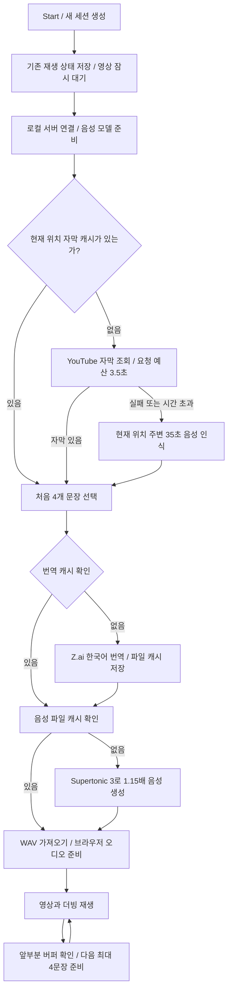
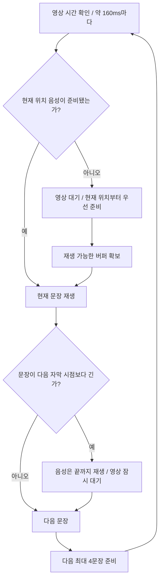

# YouTube Live Dub v0.6.0 워크플로우

> 이 문서는 Z.ai를 사용하던 시점의 검증 기록입니다. 이후 적용한 로컬 Gemma 구성과 검증 상태는 [로컬 Gemma 워크플로우](live-dub-local-gemma-2026-10-18.md)를 참고하세요.

2026-10-18 · Windows 로컬 서버 + Chrome 확장 · Supertonic 3 생성 속도 **1.15배 고정**

현재 검사 대상: [Stefan 3D AI 영상](https://www.youtube.com/watch?v=2hqcDHnyJaY).

## 시작부터 음성 출력까지



3.5초는 YouTube 자막 요청 묶음의 예산입니다. 서버 기동·페이지 정보 수집·인식·번역을 모두 포함한 시작 시간의 상한은 아닙니다. 새로운 영상에는 원본 오디오 다운로드 시간도 필요합니다.

## 재생 중 끊김을 줄이는 과정



- 영상 1배속에서 오디오 플레이어도 1배속입니다. 1.15배는 생성한 WAV에 이미 반영되며 자막 길이에 맞춘 추가 가속은 하지 않습니다.
- 약 60초 앞까지 버퍼가 유지되도록 최대 4문장씩 요청합니다. 20문장 전체를 한꺼번에 기다리는 큰 요청을 줄였습니다.
- 현재 음성이 빠졌으면 현재 위치의 2문장을 우선 준비하고 다음 요청으로 버퍼를 더 채웁니다.
- 긴 문장은 자르지 않고 영상을 잠시 기다리게 합니다. **말끝 보존과 영상의 완전 무정지는 서로 다른 조건**입니다. 고정 1.15배를 유지하기 위한 동작입니다.
- 분석이 끝난 무음 구간은 그대로 지나갑니다. 미분석 구간은 무음으로 간주하지 않습니다.

## 캐시와 작업 프로세스

| 구성 | 동작 | 구현 또는 저장 위치 |
|---|---|---|
| 원본 오디오 | 최초 다운로드 후 재사용 | `backend/.cache/source/` |
| 음성 인식 | tiny 모델, CPU int8, 시작 35초·후속 약 120초씩 확장 | `backend/stt-worker.py` |
| 모델 재사용 | 서버 시작 때 모델을 불러오고 여러 요청에 재사용 | `backend/fast-stt.js` |
| 인식 실패 복구 | 패키지·모델 부재나 인식 실패 시 기존 Whisper 경로 사용 | `lib/stt-fallback.js` |
| 분석 범위 | 발화와 별개로 무음 포함 분석한 시간 범위 기록 | `.cache/stt/*.segments.json`의 `windows` |
| 번역 캐시 | 메모리와 파일에 저장, 서버 재시작 뒤에도 재사용 | `backend/disk-text-cache.js`, `.cache/translations/` |
| 음성 캐시 | 문장·음성·속도 설정에 따른 WAV 재사용 | `.cache/audio/` |

이 PC의 빠른 인식 작업 최초 준비는 약 9.56초였습니다. 서버가 켜진 직후 Start를 누르면 이 시간이 포함될 수 있습니다. 이후 요청에는 모델을 다시 읽지 않습니다. Supertonic 3도 서버에서 유지합니다.

인식 작업이 180초 동안 응답하지 않으면 해당 작업 프로세스를 종료하고 대기 요청을 실패 처리하여 기존 Whisper 경로로 복구합니다. 다음 빠른 인식 요청은 새 프로세스를 만듭니다. 실행 중 모델을 자동 다운로드하지 않습니다.

공식 구현: [faster-whisper](https://github.com/SYSTRAN/faster-whisper), [Supertonic 3 모델](https://huggingface.co/Supertone/supertonic-3).

## 버튼과 구간 이동

| 동작 | 처리 |
|---|---|
| Start | 새 세션과 초기 버퍼를 만듭니다. 원래 재생 중이었다면 준비 후 재개합니다. |
| 영상 일시정지 | 더빙도 멈추고 사용자의 재생 조작을 기다립니다. |
| Stop | 현재 음성을 끊고 원래 음량·음소거 상태를 복구합니다. 이전 세션의 늦은 응답은 재생하지 않습니다. |
| 준비된 위치로 탐색 | 이전 음성을 멈추고 새 위치의 문장에 맞춥니다. |
| 음성이 없는 위치로 탐색 | 현재 위치부터 우선 준비하고 영상은 대기합니다. |
| 미분석 중간 구간으로 탐색 | 그 위치 주변을 우선 인식합니다. 멀리 있는 캐시를 현재 위치의 준비 완료로 계산하지 않습니다. |

중간 자막을 추가해도 기존 문장 식별자를 유지합니다. 준비 중이던 응답이 다른 문장에 연결되지 않도록 확인합니다.

## 실제 측정

조건: 현재 영상 원본 오디오가 저장된 상태, 인식·음성 모델 준비 완료, 실제 Z.ai와 Supertonic 3 사용. 기존 캐시를 삭제하지 않았습니다.

| 측정 | 결과 | 의미 |
|---|---:|---|
| 35초 자막 준비 요청 | **2.56초** | 서버 요청부터 완료 상태 확인까지 |
| 첫 4문장 번역·음성 | **10.35초** | 번역 8.60초 + 음성 1.75초, 캐시 미스 4개 |
| 같은 4문장 재요청 | **5ms** | 번역·음성 모두 캐시 적중 |
| 서버 재시작 후 재요청 | **26ms** | 파일 캐시에서 번역·음성 재사용 |
| 별도 연산 비교: 35초 입력 | **0.625초** | 모델 준비·입력 추출·HTTP 제외 |
| 별도 연산 비교: 240초 입력 | **6.784초** | 같은 모델·설정, 모델 준비 제외 |

기존 요청에서 20문장은 31.43초, 다른 4문장은 9.78초였습니다. 문장 내용과 길이가 달라 동일 조건의 배수 향상으로 해석하면 안 됩니다. 서버 시간은 Chrome의 Start부터 첫 소리가 나오는 시간과도 다릅니다.

## Z.ai를 사용하는 이유와 데이터 흐름

현재 서버의 실제 설정은 번역 `Z.ai / GLM-4.7`, 음성 생성 `Supertonic 3`입니다. Z.ai는 기존 프로젝트에 설정된 번역 제공자이며, Supertonic 3로 음성을 바꾼 뒤에도 번역 단계는 유지했습니다. 최초에 이 번역 제공자를 선택한 구체적인 이유는 현재 검증 기록만으로 확정하지 않습니다.

| 단계 | 실행 위치 | 전달되는 데이터 |
|---|---|---|
| 원문 음성 인식 | 이 PC의 Whisper 작업 | 내려받은 영상의 오디오를 로컬에서 처리 |
| 한국어 번역 | 외부 Z.ai API | 번역 캐시에 없는 원문 자막 텍스트와 번역 지시문 |
| 1.15배 음성 생성 | 이 PC의 Supertonic 3 | 한국어 번역문을 로컬에서 음성으로 변환 |
| 반복 재생 | 이 PC와 Chrome | 저장된 번역과 WAV를 재사용 |

Supertonic 3 자체가 외국어를 한국어로 번역하는 것은 아닙니다. 현재 구성 전체가 완전 로컬인 것도 아닙니다. 실측 첫 4문장 준비 10.35초 중 번역이 8.60초였으므로 추가로 시작 시간을 줄일 때 번역 경로도 검토할 대상입니다. Z.ai 사용을 중단하려면 별도의 번역 제공자 또는 로컬 번역 모델로 바꾸는 작업이 필요합니다.

## 검증 상태와 자료 보관

- JavaScript 25개 문법, 회귀 검사 **22/22**, 모의 번역·오디오 계약, Python 작업 파일 문법 검사 통과.
- 실제 로컬 서버: 35초 인식, 한국어 번역, Supertonic 3 생성, 고정 1.15배, 반복 요청과 서버 재시작 뒤 캐시 재사용 확인.
- Chrome v0.6.0을 새로고침한 뒤 실제 YouTube에서 시작·영상/더빙 동시 일시정지와 재개·미분석 570초 위치로 이동 후 준비 및 자동 재개·0초로 되돌아가 재생·Stop 뒤 음량 35%→100% 복구·재시작을 확인했습니다. 이 검사는 코드 커밋 `1c14099725ee81c87420849a11dc13d2570f910f`에서 수행했습니다.
- 실제 패널의 첫 음성 시간은 시작 **11.33초**, 다른 위치에서 재시작 **16.21초**였습니다. 기존 원본·자막·일부 번역/음성 캐시가 있는 조건이며, 같은 조건의 전후 성능 비교는 아닙니다. 미분석 구간 이동 시 영상이 대기한 뒤 새 한국어 음성이 재생됐고, 문장 끝 보존 대기도 관찰했습니다. 생성 속도 1.15배 / 오디오 플레이어 1.00배를 확인했습니다.
- GitHub 작업 브랜치와 Claude 클라우드의 코드 커밋이 `1c14099725ee81c87420849a11dc13d2570f910f`로 일치하는 것을 확인했습니다. 클라우드의 작업 트리는 깨끗하고 원격 브랜치 대비 0 ahead / 0 behind입니다. 테스트 결과 표의 상세 수치는 별도 확인 중이며, PC에서 실행한 `test:cloud` 통과와 클라우드 서버의 실행 결과는 구분합니다.
- 전체 19분 완주·모든 탐색 위치·사람이 듣는 발음과 번역 품질 평가는 완료하지 않았습니다.

상세 결과: [v0.6.0 검증 기록](../verification-2026-10-18/PERFORMANCE-v060.md).

원자료는 `docs/verification-2026-10-18/`의 `performance-backend-v060.json`, `performance-request-v060.json`, `faster-whisper-benchmark.json`, `latency-baseline-v053.json`입니다. 이 폴더는 기존 Git 제외 정책에 따라 로컬에 보관합니다. 이 워크플로우는 `docs/workflows/`에 있어 소스와 함께 버전 관리할 수 있습니다.

```powershell
cd "$env:USERPROFILE\youtube-live-dub-mvp"
.\scripts\start-local.ps1
npm.cmd run test:cloud
```

빠른 인식 패키지가 없는 PC는 `requirements-stt-fast.txt`와 tiny 모델을 별도로 준비해야 합니다. 이 PC에는 둘 다 이미 있습니다. 없으면 기존 Whisper 경로를 쓰므로 빠른 인식 측정값은 적용되지 않습니다.

확장과 YouTube 페이지를 새로고침한 후 패널 `재생 진단`에서 첫 음성까지 시간, 최근 준비 시간, 버퍼 대기·문장 끝 대기 횟수를 볼 수 있습니다. 번역 API 키는 서버 환경 설정에만 두며 자료에는 포함하지 않습니다.
