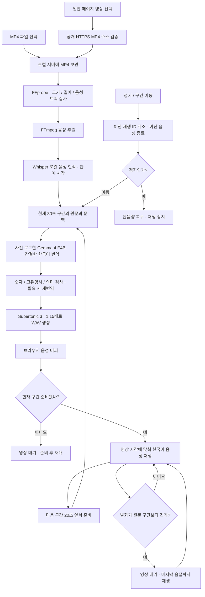
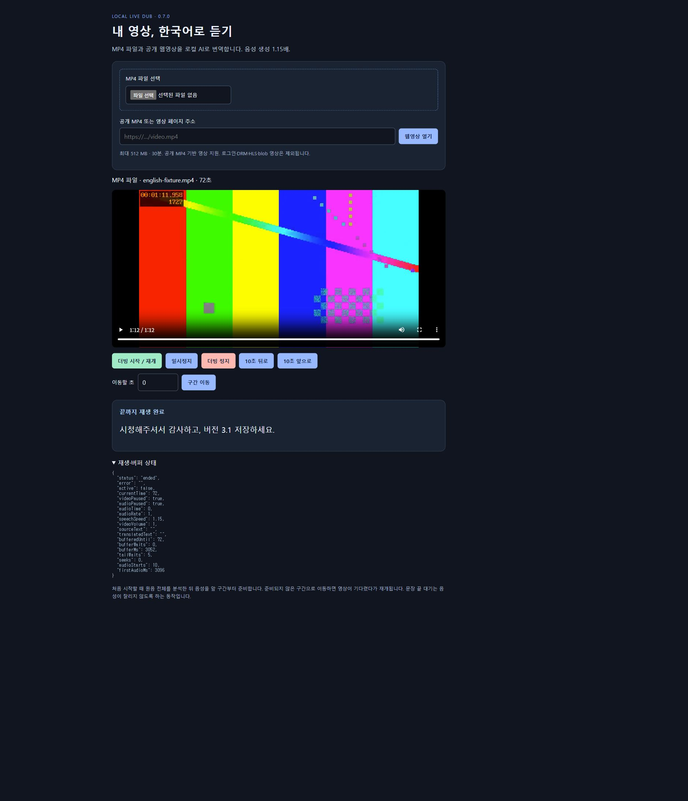

# MP4 · 일반 웹영상 더빙 — v0.7.0

## 지원 범위와 사용 순서

Windows에서 `install-windows.cmd`로 설치한다. 기존 GPU/CPU 자동 선택, Gemma 사전 로드, Supertonic **생성 속도 1.15배**를 유지한다. 설치가 끝나면 `http://127.0.0.1:18789/player`가 열린다. 다음 실행은 `start-player.cmd`다.

1. **MP4 파일 선택**, 또는 공개 HTTPS MP4/영상 페이지 주소를 넣고 **웹영상 열기**.
2. **더빙 시작 / 재개**. 최초에는 원음 전체를 분석하고 현재 구간을 번역한다.
3. **일시정지**는 화면·음성을 함께 멈춘다. 같은 시작 버튼으로 이어 듣는다.
4. **10초 뒤로/앞으로**, 초 입력 후 **구간 이동**, 또는 영상 자체 탐색 막대를 사용한다.
5. **더빙 정지**는 음성을 즉시 끊고, 이전 요청의 늦은 결과를 무시하며 원음량을 복구한다. 영상도 정지한다.

일반 페이지에서는 확장 팝업의 **현재 페이지 영상 찾기**를 누르고 영상을 선택한다. 선택한 원본 영상이 일시정지되고 MP4 주소가 로컬 플레이어 입력란에 전달된다. **웹영상 열기**를 눌러 가져온다. `activeTab` 권한으로 사용자가 선택한 페이지의 최상위 `<video>`를 확인하며 전체 사이트 상시 접근 권한을 추가하지 않았다.

| 입력 | 지원 |
|---|---|
| 로컬 MP4 | 파일 선택 → 같은 PC의 서버로 복사 → 로컬 재생 |
| 공개 HTTPS MP4 URL | 서버가 검증·다운로드 → 로컬 재생 |
| MP4가 명시된 정적 HTML | `<video src>` / `<source src>` 추출. 하나면 가져오고 여러 개면 선택 버튼 표시 |
| 동적으로 만든 공개 MP4 | 확장 팝업에서 현재 재생 주소 찾기 |
| 여러 영상 / iframe | 영상을 선택하거나 iframe 원본 페이지 직접 열기 |
| 로그인·쿠키·DRM·HLS·blob·라이브 | 현재 미지원. 이를 우회하거나 성공으로 표시하지 않음 |

한 파일 최대 512 MB, 30분. 영상·음성 트랙이 모두 필요하며 Chrome에서 재생 가능한 **H.264/AAC MP4**를 권장한다. HTTP/사설 IP/인증정보가 포함된 URL은 거부한다. 원래 SNS 페이지 위에 더빙하는 기능은 이번 지원 범위에 없다.

## 처리 흐름

**1.15배는 음성 생성 단계에만 반영한다.** 기본 영상 속도 1이면 음성 플레이어도 1이다. 사용자가 영상 재생 속도를 바꾸면 음성도 그 속도를 따른다. 문장 길이에 맞추기 위한 추가 가속은 없다.

## 버퍼·취소·보안

- 준비 요청은 현재 구간과 다음 구간을 제한적으로 실행한다. 서버는 동시 준비 최대 2개, 합성은 4문장 단위로 취소 여부를 확인한다. 이미 시작한 모델 호출은 끝날 수 있지만 결과가 정지한 플레이어를 재개하지 않는다.
- 브라우저는 최대 6개 30초 구간의 음성을 보관하고 멀어진 구간의 Blob URL을 해제한다. 뒤로 이동하면 서버 준비 캐시를 재사용한다.
- 원본 영상의 `waiting` 동안 음성도 기다린다. 사용자가 일시정지했다면 `canplay`가 와도 자동 재개하지 않는다.
- 음성이 원문 구간보다 길면 영상만 잠시 멈춰 끝까지 말한다. 이는 버퍼 부족과 따로 표시한다. 총 시청 시간이 원본보다 늘어날 수 있다.
- 새 MP4 API는 로컬 Host, 같은 Origin, 세션 토큰을 확인한다. 공개 URL의 DNS 결과와 리다이렉트마다 사설/예약 IP를 차단하고 검증한 IP로 접속한다. FFmpeg 입력 프로토콜도 로컬 파일로 제한한다.
- 원본·음성·전사 결과는 `backend/.cache`에 남으며 GitHub에 포함하지 않는다. 자동 삭제하지 않는다. 서버 재시작 후에는 파일을 다시 선택한다. 세션 최대 24개 가져오기이며 잘못된 업로드의 부분 파일도 캐시에 남을 수 있다.

## 검증 기록

실제 Chrome + 로컬 Whisper/Gemma/Supertonic 검사와 테스트용 가짜 모델 검사를 구분한다. 수치는 이 PC에서 관찰한 값이며 다른 GPU/CPU의 성능 보장이 아니다.

### 실제 재생

- 자체 제작 영문 테스트 MP4: 72초, 640×360 H.264/AAC, 5개 발화 구간에서 전사 10문장. Chrome 파일 선택 창으로 업로드했다.
- 공개 웹영상: [W3C HTML5 Video 데모](https://www.w3.org/2010/05/video/mediaevents.html)의 [Sintel 예고편 MP4](https://media.w3.org/2010/05/sintel/trailer.mp4), 약 52.21초. 외부 영상 자체는 저장소에 게시하지 않는다.
- 로컬 모델: Whisper `large-v3-turbo / CUDA int8_float16`, Ollama `gemma4:e4b-it-q4_K_M`, Supertonic 3.
- MP4 최초 음성 준비 약 14.05초, 준비된 마지막 구간 재시작 약 44ms 관찰. 최초 전체 전사 비용과 소스 자체의 무음 시간을 구별해야 한다.
- MP4 시작·발화 중 일시정지/재개·43초 앞으로·1초 뒤로 이동·정지·58초 재시작·72초 끝까지 완료를 확인했다. 정지 시 이전 음성이 종료되고, 마지막 문장은 `버전 3.1`을 유지했다.
- 공개 웹영상은 다운로드·실제 한국어 음성 생성, 준비 도중 정지 후 늦은 응답 무시, 35초 앞으로/12초 뒤로 이동, 발화 중 일시정지를 확인했다.
- 첫 웹영상 검사에서 이유를 묻는 문장이 예/아니오 질문으로 약해지는 번역을 발견해 v13에서 방문 이유 질문의 의미 보존 검사와 재번역을 추가했다.

### 최종 수정본 재검사

- W3C HTML 페이지 주소에서 MP4 2개를 찾고, `media.w3.org` 항목을 사용자가 고르는 실제 UI 흐름을 확인했다. 웹페이지 주소와 직접 MP4 주소를 모두 검사했다.
- v13의 실제 재번역: `What brings you to the land of the gatekeepers?` → `게이트키퍼의 땅에 오신 이유가 무엇인가요?`. 이유를 묻는 의미를 복원했다.
- 빠른 탐색 직후 일시정지에서 예전 `play()` 요청의 거절이 새 재생을 정지시키는 문제를 발견했다. 음성 객체와 재생 ID를 확인하고 정상적인 `AbortError`를 처리하도록 수정했다.
- 수정 후 **35초 → 12초 → 일시정지**를 3회 연속 반복했다. 각 결과는 `active: true`, `videoPaused: true`, `audioPaused: true`, 오류 없음으로 재개 가능한 상태였다. 이어서 시작 버튼으로 영상·음성이 함께 재개됐다.
- 준비되지 않은 MP4 구간으로 초기 이동 시 약 7.3초 준비 후 해당 위치에서 재생 복구를 확인했다. 정지 시 UI에서 `videoVolume: 0.2 → 1` 복구와 `active: false`를 확인했다.
- 최종 웹영상의 12초 시작 지점은 약 1.21초 준비 후 실제 음성이 시작됐다. 일부 번역 파일 캐시를 재사용한 수치이며 완전한 무캐시 성능이 아니다.
- 수정 완료 후 MP4를 **0초부터 72초까지 연속 재생**했다. 10문장 모두 재생됐고 오류 0, 최초 준비 이후 추가 버퍼 부족 0회, 긴 문장 끝 대기 5회였다. 첫 음성은 3.096초 후 나왔으며 이전 검사의 번역 캐시를 재사용한 재검사다. 종료 후 원음량은 1로 복구됐다.
- 실제 준비 API의 10개 고유 음성 응답을 따로 확인했다. 모두 `speechSpeed: 1.15`, `ttsModel: supertonic-3`, 길이 양수였다. UI의 고정 문구만으로 생성 속도를 판단하지 않았다.
- 웹영상도 최종 52.21초에 `ended`, 오류 없음, 원음량 복구를 확인했다.

원시 재생 상태와 반복 탐색 결과: [검증 데이터 JSON](../qa/mp4-web-v0.7.0.json).

자동 검사는 JavaScript 회귀 **67개**, Windows 설치기 모의 검사 **13개**, Python 설치 보조 모의 검사 **4개**다. `-Plan`으로 이 PC의 Node/Python/FFmpeg/Ollama/Chrome 탐지와 GPU 메모리 조회도 실행했다. 실제 서버 시작과 3개 모델 ready를 확인했지만 새 PC를 초기 상태에서 재설치한 것은 아니다.

Chrome 도구모음 팝업은 자동 브라우저 도구가 제어하지 못해 v0.7.0 새로고침 및 팝업 클릭은 사용자 확인 단계다. MP4/웹영상 플레이어는 이 팝업 없이 직접 URL로 사용할 수 있으며 위의 실제 재생 검사는 확장 등록에 의존하지 않는다.

### 자동 검사와 한계

`npm run test:cloud`: JS 구문·버전, 회귀 테스트, 번역/WAV 모의 계약, Windows 설치기 제어 흐름을 검사한다. 외부 다운로드 및 새 PC 설치를 수행한 결과가 아니다. CPU 신규 설치, 모든 MP4 코덱, 30분 상한 파일, 모든 일반 웹사이트, 실제 네트워크 장애 재현은 별도 검증이 필요하다. 번역 의미·발음 전체를 사람의 청감으로 전수 검수한 것은 아니다.

첫 시작에는 **전체 파일 음성 인식**이 필요하다. 긴 파일과 CPU에서는 대기가 길어지거나 음성 인식 제한 시간(180초)을 넘길 수 있다. 그 경우 명시적인 오류가 나오며 음성을 만들어낸 것처럼 진행하지 않는다. 초기 지연을 더 줄이는 다음 단계는 영상 파일에 대한 점진적 전사다.
